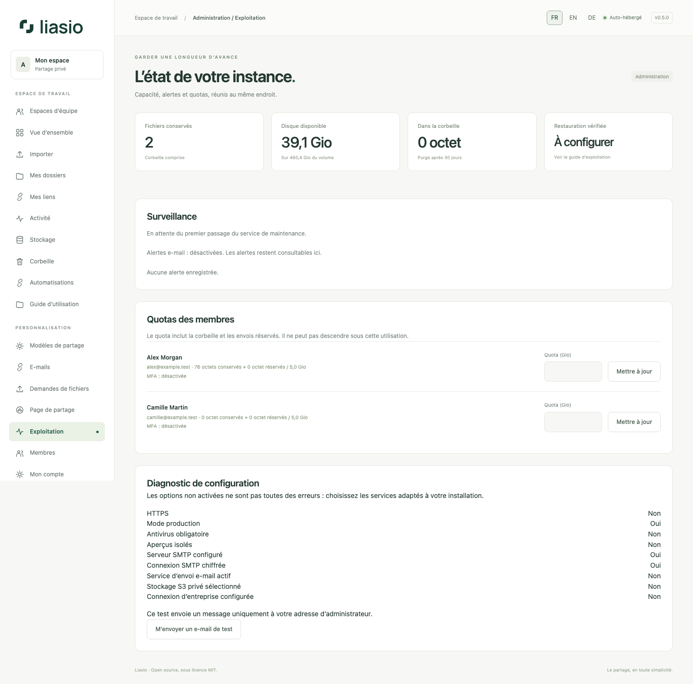

# Hébergement avancé et protection des comptes

Dans **Exploitation**, l’administrateur consulte disque, quotas, maintenance, antivirus, sauvegardes et diagnostic de configuration. Une option désactivée n’est pas nécessairement une erreur. Le test SMTP écrit uniquement à votre adresse d’administrateur et affiche son état dans **E-mails** ; il ne modifie pas les réglages du serveur mail.

## Sessions et identité d’entreprise

Dans **Mon compte → Sessions actives**, consultez cet appareil et les autres sessions avec leur dernière activité. Les intitulés proviennent du navigateur ; aucune adresse IP n’est enregistrée. Déconnectez un autre appareil ou tous les autres, sans fermer la session actuelle. Les changements de mot de passe/MFA conservent leurs règles d’invalidation. Un ancien appareil peut rester non renseigné jusqu’à sa prochaine utilisation.

Si l’exploitant configure OIDC, **Connexion d’entreprise** apparaît. Connectez-vous localement, confirmez mot de passe et code MFA éventuel, puis associez explicitement votre identité. Une adresse e-mail identique ne relie jamais automatiquement les comptes. Suspension et MFA locale restent appliquées. Le mot de passe demeure utilisable si le fournisseur est indisponible ; la déconnexion locale ne ferme pas sa session.

## Stockage et sauvegardes

Le stockage S3 privé est facultatif et configuré sur le serveur. Aucun lien direct d’original ne contourne les autorisations. Les imports temporaires et téléchargements exigent encore du disque local ; fichiers actuels, versions et corbeille comptent dans le quota. Le [guide détaillé d’hébergement](../../ADVANCED_HOSTING.md) explique les droits nécessaires et la migration avec vérification des empreintes.

Les sauvegardes chiffrées hors serveur utilisent restic avec rétention configurable. L’export comprend base, versions des fichiers, blocs en attente et configuration chiffrée ; la cible de restauration doit être vide. Testez une récupération complète sur un autre serveur et conservez le mot de passe du dépôt ailleurs que sur le VPS. Voir [les sauvegardes](../../OFFSITE_BACKUPS.md) et [la mise à niveau 0.5](../../UPGRADING_0_5.md).

SMTP, OIDC, S3 et sauvegarde distante nécessitent vos paramètres d’exploitation ; ils ne s’activent pas silencieusement. L’audit humain indépendant reste à réaliser : [dossier de préparation](../../INDEPENDENT_AUDIT.md).
