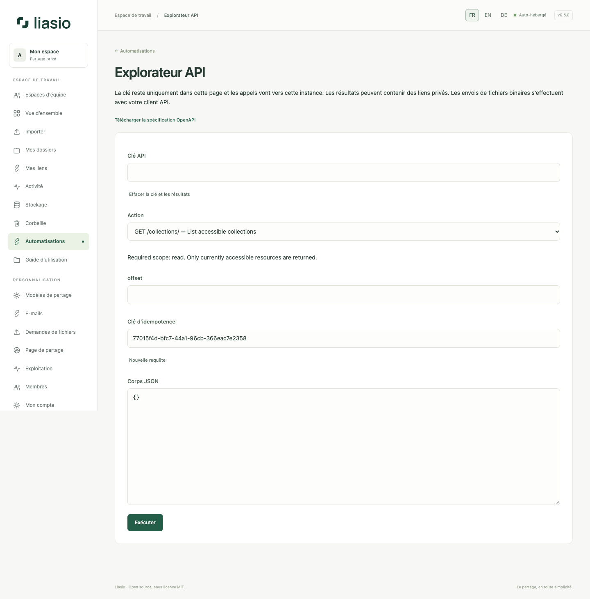

# Tester l’API dans le navigateur

1. Créez une clé dans **Automatisations**, avec seulement les droits nécessaires. Gardez-la privée et vérifiez son expiration. La connexion au site ne remplace pas une clé API.
2. Ouvrez **l’explorateur API**. Collez la clé dans le champ masqué : elle reste en mémoire dans la page, sans stockage navigateur ni paramètre d’URL. Tous les appels visent cette instance et n’utilisent pas les cookies.
3. Choisissez une action. Commencez par `GET /collections/` pour trouver l’UUID d’un dossier accessible, puis renseignez-le dans le chemin. Lecture : `read` ; création : `files:write` ou `links:write`.
4. Pour modifier les données, vérifiez le JSON, conservez la clé d’idempotence, cochez la confirmation et exécutez. Après une panne réseau, réutilisez cette clé avec exactement le même contenu pour retenter une création. **Nouvelle requête** prépare une nouvelle opération volontaire.
5. Consultez le statut HTTP et la réponse. Les lots renvoient chaque nom avec son URL dans l’ordre, un lien vers **Mes lots** et les exports Excel/CSV. L’export affiche un bouton de téléchargement. Utilisez votre client API pour les blocs binaires des fichiers.
6. Cliquez sur **Effacer la clé et les résultats** en terminant. Ne publiez pas de captures de réponses contenant des liens privés. Quitter/fermer la page efface la clé ; un rechargement ne la conserve pas.

La [spécification OpenAPI 3.1](../../openapi.json), également accessible à `/api/openapi.json`, décrit routes, droits, paramètres, statuts, pagination et contrôles des blocs. L’explorateur utilise ce contrat versionné, sans script externe ni CDN. Voir [la référence API](../../API.md), [les lots](bulk-links-api.md) et [les imports](automation.md).
