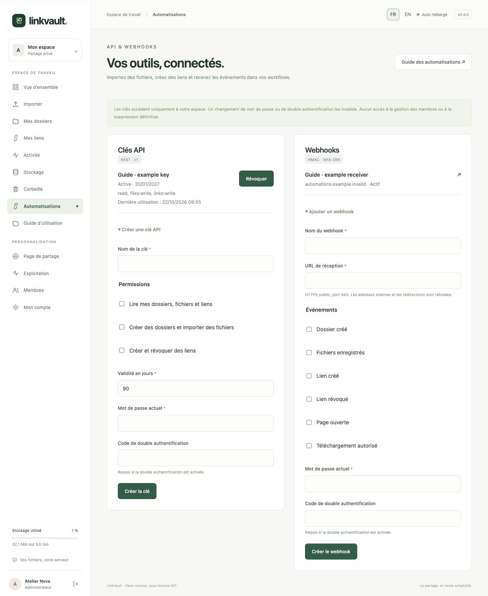
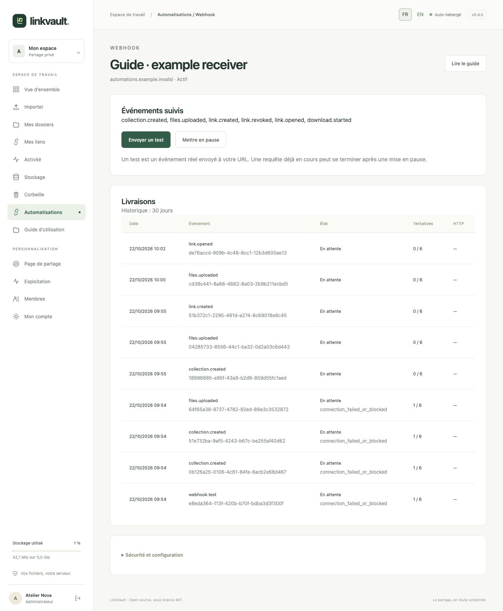

# Automatiser avec l’API et les webhooks

L’**API reçoit les commandes** de vos outils : créer un dossier, envoyer ses fichiers et créer un lien. Les **webhooks envoient les notifications** à vos outils lorsque des événements se produisent. Une URL de webhook seule n’autorise pas les imports.



## 1. Créer une clé API limitée

Ouvrez **Automatisations → Créer une clé API**. Donnez-lui un nom clair, choisissez les seules permissions nécessaires et une validité de 1 à 365 jours (90 par défaut). Confirmez le mot de passe actuel et, si activée, un nouveau code MFA ou de récupération.

| Permission | Accès |
| --- | --- |
| `read` | Lire vos dossiers, métadonnées de fichiers, liens et progression des envois. Les réponses de liens incluent l’URL privée de partage. |
| `files:write` | Créer des dossiers, commencer/envoyer/finaliser/annuler des imports. |
| `links:write` | Créer et révoquer des liens. |

Copiez immédiatement la clé dans le coffre de votre outil. Elle n’est affichée qu’une fois ; seule une empreinte cryptographique est conservée. Dix clés non expirées et non révoquées maximum. Elles ne permettent ni de gérer les comptes, ni d’accorder des droits, ni de modifier la personnalisation, ni de supprimer les fichiers. **Révoquer** coupe les prochaines utilisations. Un changement de mot de passe/MFA invalide les clés ; une suspension les révoque définitivement.

Envoyez toujours `Authorization: Bearer VOTRE_CLE` en HTTPS. Ne placez jamais une clé dans une URL, Git, une capture ou un workflow public. Les cookies du navigateur n’authentifient pas l’API.

## 2. Importer un fichier ou un dossier et obtenir un lien

Le dépôt inclut un client Python 3.12+ sans bibliothèque supplémentaire. Définissez `LINKVAULT_API_KEY` dans votre environnement privé ou votre coffre, puis exécutez :

```sh
python3 examples/upload.py ./livraison \
  --url https://fichiers.example.com \
  --title "Livraison client" \
  --state ./etat-livraison.json \
  --max-downloads 1 --hours 168 --previews
```

Gardez le fichier d’état **hors** du dossier envoyé. Relancez la même commande avec les mêmes fichiers et le même état pour reprendre ; utilisez un nouvel état pour un nouvel envoi. Ne modifiez pas les fichiers pendant l’import. Le client écrit les informations du lien sur la sortie standard et la progression sur la sortie d’erreur. La sortie contient l’URL privée : protégez les journaux. La variable facultative `LINKVAULT_LINK_PASSWORD` ajoute un mot de passe d’au moins 12 caractères.

Choisissez un titre de 120 caractères maximum ; ses 80 premiers caractères deviennent le libellé du lien. Les liens symboliques ne sont pas acceptés.

Le client utilise les trois permissions, vérifie chaque bloc et reprend aux positions enregistrées. Les imports en attente expirent après 24 heures. Les identifiants de dossier/lien sont sauvegardés localement ; les reçus de création durent 24 heures : reprenez rapidement si la connexion s’est coupée avant l’enregistrement d’un identifiant. La [référence API](../../API.md) détaille routes, champs, limites et erreurs.

## 3. Ajouter un webhook sortant

Cliquez sur **Ajouter un webhook**, indiquez un nom et l’**URL HTTPS publique** du destinataire, choisissez les événements puis confirmez le mot de passe/MFA. Seul le port 443 est autorisé. Les IP privées/internes, identifiants dans l’URL, paramètres de requête, fragments et redirections sont refusés. Pour n8n sur le même VPS, utilisez son domaine HTTPS public, pas un nom Docker ni `localhost`.

Copiez le **secret de signature** et configurez sa vérification chez le destinataire. Ce secret est distinct de la clé API. L’URL et le secret sont chiffrés en base. Les notifications contiennent les identifiants d’événement/dossier/lien, sans URL de partage, mot de passe, e-mail ni contenu de fichier. Une clé API séparée et limitée permet au destinataire de lire les détails si nécessaire.

Événements : `collection.created`, `files.uploaded`, `link.created`, `link.revoked`, `link.opened`, `download.started`. `files.uploaded` indique un enregistrement final réussi, après l’analyse applicable ; `download.started` indique un transfert autorisé, pas une réception prouvée. La mise à la corbeille peut générer des révocations. L’expiration automatique ne produit pas `link.revoked`.

## 4. Vérifier et tester les livraisons



Ouvrez le webhook et cliquez sur **Envoyer un test**. Un véritable événement `webhook.test` est mis en attente pour votre URL. Actualisez pour voir l’état, le statut HTTP et le nombre de tentatives. Le service de livraison doit fonctionner ; voir [Exploitation](operations.md).

Le destinataire doit vérifier les octets bruts avant de lire le JSON :

```text
X-LinkVault-Timestamp: SECONDES_UNIX
X-LinkVault-Signature: v1=HMAC_SHA256_HEXADECIMAL
Octets signés = timestamp + "." + corps HTTP brut
Clé HMAC = secret de signature encodé en UTF-8
```

Utilisez une comparaison à temps constant et refusez un écart d’horloge supérieur à cinq minutes. Le [vérificateur Python testé](../../../examples/verify_webhook.py) réalise ces contrôles. Enregistrez l’`id` du contenu avec votre résultat de traitement, sous contrainte d’unicité : les livraisons sont **au moins une fois**, peuvent arriver dans le désordre et doivent être dédupliquées. `X-LinkVault-Delivery` identifie une livraison ; l’ID d’événement est partagé entre destinataires abonnés. Répondez rapidement en 2xx après acceptation durable, puis traitez les longues actions de façon asynchrone.

Six tentatives maximum : immédiate, puis environ 1 minute, 5 minutes, 30 minutes, 2 heures et 6 heures après chaque échec, avec un léger décalage aléatoire. Les erreurs réseau et HTTP 408/425/429/5xx sont réessayées ; les redirections et autres 4xx échouent sans reprise. Chaque tentative est limitée à 20 secondes. Le corps de réponse n’est pas conservé. Historique : 30 jours. Une file de 1 000 livraisons en attente met le webhook en pause avec une alerte ; les événements pendant la pause ne sont pas conservés.

## 5. Connecter n8n

1. Enregistrez la clé API dans une credential **Header Auth** : en-tête `Authorization`, valeur `Bearer …`.
2. Utilisez des nœuds **HTTP Request** avec les méthodes et JSON de la [référence](../../API.md). Gardez la même `Idempotency-Key` lors d’une nouvelle tentative de la même création. Pour les fichiers, utilisez les blocs du protocole reprenable, jamais du base64 dans le JSON. Le client Python fourni peut servir dans un processus d’import externe supervisé.
3. Ajoutez un déclencheur n8n **Webhook** en POST. Utilisez son **URL de production** et publiez/activez le workflow avant de l’enregistrer dans LinkVault. Les URL de test n’écoutent que temporairement.
4. Vérifiez le HMAC sur le corps brut, l’horodatage et les doublons **avant les actions**. Si le workflow ne conserve pas les octets d’origine, placez un vérificateur devant n8n avec la fonction Python fournie. Une URL difficile à deviner ne remplace pas la signature.
5. Envoyez un test LinkVault, vérifiez `webhook.test`, puis abonnez-vous aux événements réels. Évitez une boucle si votre workflow crée lui-même des liens et écoute `link.created`.

## Mettre en pause, renouveler ou supprimer

**Mettre en pause** annule la file ; une requête déjà partie peut se terminer. **Réactiver** exige mot de passe/MFA et concerne uniquement les futurs événements. **Renouveler le secret** invalide immédiatement l’ancien ; toutes les prochaines tentatives, y compris les reprises, utilisent le nouveau. Coordonnez la modification du destinataire. Pour changer l’URL ou les événements, créez et testez un remplaçant puis supprimez l’ancien. La suppression efface son historique. Ces actions ne suppriment ni vos dossiers ni vos clés API.

Références n8n : [Webhook trigger](https://docs.n8n.io/integrations/builtin/core-nodes/n8n-nodes-base.webhook/) · [HTTP Request credentials](https://docs.n8n.io/integrations/builtin/credentials/httprequest/).
