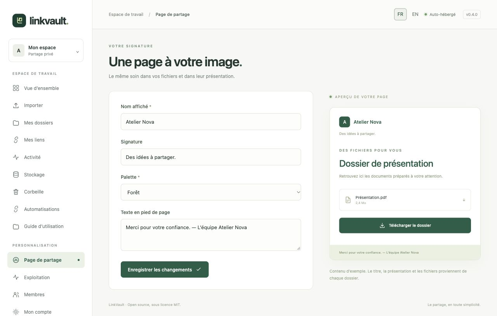

# Personnaliser sa page de partage

Ouvrez **Page de partage** dans le menu. Votre personnalisation s’applique à toutes vos pages destinataires, y compris aux liens existants ; les autres membres conservent leur propre personnalisation.

1. Indiquez le **Nom affiché** : votre studio, votre équipe ou votre nom. Sa première lettre forme le monogramme.
2. Ajoutez une **Signature** courte pour présenter votre espace.
3. Choisissez la palette **Forêt**, **Océan**, **Prune** ou **Encre**. L’aperçu évolue pendant la modification.
4. Complétez le **Texte en pied de page**, par exemple avec un contact ou une note d’accompagnement.
5. Cliquez sur **Enregistrer les changements**, puis ouvrez un lien pour vérifier le résultat. L’ouverture d’un véritable lien peut apparaître dans l’activité.

Le fichier montré dans l’aperçu des paramètres est un exemple. Le titre réel, la présentation, le message et les fichiers proviennent de chaque [dossier](collections.md). Les aperçus des fichiers se règlent [par lien](sharing.md).

Ces champs acceptent du texte, sans scripts ni HTML personnalisé. L’interface peut être en français ou en anglais ; vos textes restent tels que vous les avez saisis. Rédigez un contenu bilingue si vos destinataires en ont besoin.
