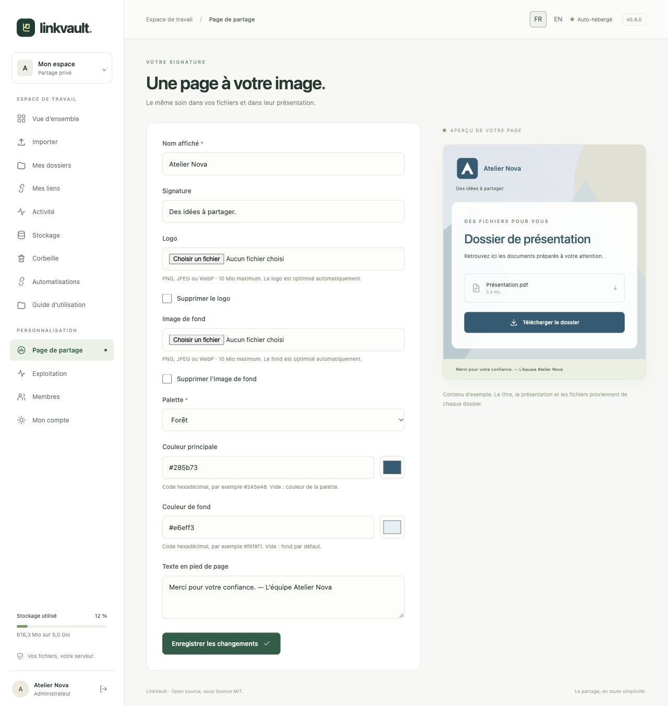
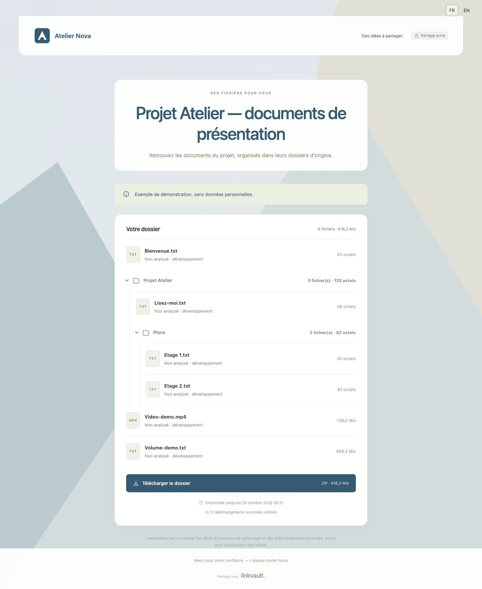

# Personnaliser sa page de partage

Ouvrez **Page de partage** dans le menu. Votre personnalisation s’applique à toutes vos pages destinataires, y compris aux liens existants ; les autres membres conservent leur propre personnalisation.

1. Indiquez le **Nom affiché** et une **Signature** courte.
2. Ajoutez votre **Logo**, puis une **Image de fond** si vous le souhaitez. PNG, JPEG et WebP sont acceptés, jusqu’à 10 Mio par image avant optimisation. Le navigateur conserve les proportions, optimise les dimensions et prépare un PNG. L’aperçu s’actualise ; attendez « Image prête ».
3. Choisissez une palette **Forêt**, **Océan**, **Prune** ou **Encre**. Pour des couleurs précises, utilisez les sélecteurs **Couleur principale** et **Couleur de fond**, ou saisissez un code comme `#285b73`. Effacez le code pour revenir à la palette. La couleur du texte des boutons s’adapte pour rester lisible.
4. Complétez le **Texte en pied de page**, par exemple avec une note d’accompagnement.
5. Cliquez sur **Enregistrer les changements**. Les modifications de l’aperçu ne sont pas enregistrées tant que vous n’avez pas cliqué sur ce bouton.

Pour remplacer une image, sélectionnez-en une nouvelle. Pour la retirer, cochez **Supprimer le logo** ou **Supprimer l’image de fond**, puis enregistrez. Le monogramme revient lorsque le logo est retiré.

Le contenu de l’aperçu des paramètres est fictif. Le titre réel, la présentation, le message et les fichiers proviennent de chaque [dossier](collections.md). Les aperçus des fichiers se règlent [par lien](sharing.md).

Les images enregistrées sont limitées à 512 × 512 pixels / 512 Kio pour le logo et 1 600 × 1 600 pixels / 2 Mio pour le fond. Elles sont contrôlées, débarrassées de leurs métadonnées, analysées par l’antivirus en production et conservées dans la base sauvegardée. Leur espace apparaît dans [Stockage](storage.md), séparément du quota des fichiers. Sans JavaScript, fournissez directement un PNG RVB/RVBA 8 bits non entrelacé respectant ces limites.

Les images de personnalisation suivent les conditions du lien : mot de passe, expiration, révocation, nombre de téléchargements et compte actif. Elles ne consomment pas de téléchargement. Cette fonctionnalité reste utilisable lorsque les aperçus de documents sont désactivés sur le serveur. Les champs de texte ne permettent pas de HTML ni de scripts. Vos textes restent dans la langue choisie par vous.
