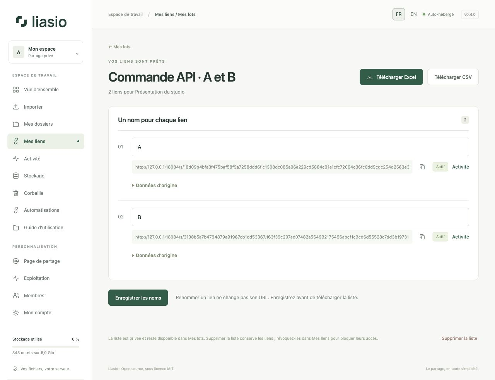
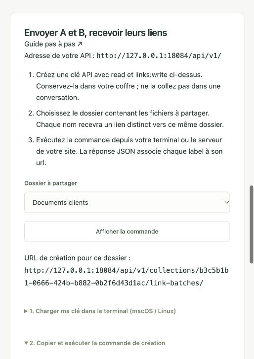

# Créer et exporter des lots par API

Depuis Codex, un terminal, n8n ou le serveur de votre site, envoyez des noms à Liasio et récupérez leurs liens. Le lot apparaît aussitôt dans **Mes liens → Mes lots**, comme un lot créé dans l’interface. Tous les liens d’un lot partagent **le même dossier de fichiers**.



## Démarrer sans chercher les adresses

Ouvrez **Automatisations → Préparer ma commande**. Sélectionnez le dossier et cliquez sur **Afficher la commande** : l’URL contient déjà le domaine de votre instance et l’identifiant du dossier. Le bloc explique comment charger votre clé dans un terminal macOS/Linux sans l’inscrire dans l’historique, puis copier la commande. Remplacez les noms A et B par les vôtres. Aucun webhook n’est nécessaire.

Pour une clé durable, choisissez **Sans expiration** lors de sa création. Cette validité concerne la clé API ; l’expiration des liens créés se règle séparément dans `conditions`. La commande proposée dans l’interface omet ces conditions et crée donc des liens sans expiration ni limite de téléchargement.

La réponse associe `items[].label` à `items[].url`. Pour exporter facilement depuis le navigateur, ouvrez **Mes liens → Mes lots**, sélectionnez le lot et cliquez sur **Télécharger Excel** ou **Télécharger CSV**. Une adresse d’export `/api/v1/…` exige toujours l’en-tête Bearer et ne s’ouvre pas directement avec les cookies de connexion.



## 1. Préparer l’accès

Dans **Automatisations → Créer une clé API**, cochez `links:write` pour créer et `read` pour consulter et exporter. Conservez la clé dans la variable d’environnement privée `LINKVAULT_API_KEY`. Ce nom est conservé pour la compatibilité de l’API v1. Ne la mettez ni dans Git, ni dans un lien, ni dans le JavaScript livré aux visiteurs de votre site.

Le dossier doit déjà contenir ses fichiers validés. Retrouvez son UUID dans l’URL `/collections/UUID/` de l’interface ou avec `GET /api/v1/collections/`. Pour importer les fichiers par API, suivez le [guide des automatisations](automation.md).

## 2. Envoyer A et B, recevoir le lien A et le lien B

Créez un fichier privé `request.json` :

```json
{
  "name": "Clients — octobre",
  "names": ["A", "B"],
  "conditions": {"expires_in_days": 7, "max_downloads": 1}
}
```

Appelez `POST /api/v1/collections/UUID/link-batches/` avec `Content-Type: application/json`, `Authorization: Bearer VOTRE_CLE` et une valeur unique de `Idempotency-Key` pour cette opération. Avec le [client Python fourni](../../../examples/batches.py), depuis une copie du dépôt :

```sh
# LINKVAULT_API_KEY est déjà définie dans l’environnement privé.
umask 077
python3 examples/batches.py --url https://files.example.com create \
  --collection UUID_DU_DOSSIER --request request.json \
  --idempotency-key clients-octobre-001 > batch.json
```

Remplacez le domaine et l’UUID par ceux de votre instance. Python 3.12+ suffit ; ce client utilise la bibliothèque standard. La sortie contient notamment, sous cette forme abrégée :

```json
{
  "id": "UUID_DU_LOT",
  "name": "Clients — octobre",
  "state": "complete",
  "items": [
    {"position": 1, "label": "A", "url": "https://votre-instance/s/LIEN_A/"},
    {"position": 2, "label": "B", "url": "https://votre-instance/s/LIEN_B/"}
  ]
}
```

Chaque élément réel comprend aussi l’ID du lien, son statut, ses compteurs et ses conditions. **L’ordre est celui de `names`** ; les positions commencent à 1. Deux noms identiques produisent deux liens distincts : utilisez la position ou l’ID pour les distinguer. Les espaces autour des noms sont retirés. Les URL de partage sont privées ; protégez `batch.json` et évitez de les enregistrer dans les journaux.

Pour une quantité, remplacez `names` par `"count": 20` : les noms proposés sont `Link 001` à `Link 020`. Fournissez exactement l’un des deux champs. Chaque lot contient 1 à 200 liens ; le nom du lot et chaque nom de lien sont limités à 80 caractères sur une ligne.

`conditions` est facultatif. Il accepte `expires_in_days` **ou** `expires_at` avec fuseau horaire, `max_downloads`, `password` et `allow_previews`. Sans conditions : pas d’expiration, téléchargements illimités, aucun mot de passe et aperçus désactivés. Une limite de 1 autorise un téléchargement **par lien**. La durée commence à la création. Le mot de passe n’est jamais renvoyé ni exporté ; si vous l’incluez dans le fichier de requête, protégez aussi ce fichier.

## 3. Consulter et exporter

```sh
python3 examples/batches.py --url https://files.example.com list
python3 examples/batches.py --url https://files.example.com get UUID_DU_LOT
python3 examples/batches.py --url https://files.example.com export UUID_DU_LOT \
  --format xlsx --output liens.xlsx
python3 examples/batches.py --url https://files.example.com export UUID_DU_LOT \
  --format csv --output liens.csv
```

Les commandes correspondent à `GET /api/v1/link-batches/`, `GET /api/v1/link-batches/UUID/` et `GET /api/v1/link-batches/UUID/export/xlsx/` ou `/csv/`. La liste est paginée par 50 : utilisez `--offset 50` à partir du `next_offset` renvoyé ; `--collection UUID` permet de filtrer. Les URL `api_url` et `exports` de la réponse exigent la clé API ; `view_url` ouvre le lot après connexion à l’interface.

Les exports contiennent le nom d’origine, le nom actuel, l’URL et les dates/statuts/compteurs. Les nombres saisis comme noms, par exemple `00127`, restent du texte. Les formules sont neutralisées. Le client crée les exports avec des droits privés et refuse d’écraser un fichier existant. Pour réexporter, choisissez un nouveau nom de fichier.

L’API peut également consulter et exporter les lots créés dans l’interface, y compris leurs colonnes Excel/CSV d’origine. Un brouillon est consultable (`draft` ou `expired`), mais ne contient pas de liens et n’est pas exportable. L’API crée directement des lots terminés ; elle reçoit du JSON, pas un classeur Excel brut. Utilisez l’interface pour [importer un classeur](bulk-links.md).

## 4. Depuis un site web ou un webhook

Le serveur de votre site appelle cette même API avec sa clé privée. Exemple JavaScript **côté serveur**, après avoir authentifié et autorisé l’utilisateur de votre site :

```javascript
const response = await fetch(`${process.env.LIASIO_URL}/api/v1/collections/${collectionId}/link-batches/`, {
  method: "POST",
  redirect: "error",
  headers: {
    "Authorization": `Bearer ${process.env.LINKVAULT_API_KEY}`,
    "Content-Type": "application/json",
    "Idempotency-Key": operationId
  },
  body: JSON.stringify({name: "Clients", names: ["A", "B"]})
});
if (!response.ok) throw new Error(`Liasio HTTP ${response.status}`);
const batch = await response.json();
// batch.items associe chaque label à son URL ; conserver batch.id.
```

Conservez `operationId` et le corps JSON pour les reprises, et l’ID du lot après succès. Choisissez le dossier du côté serveur selon les droits de votre propre utilisateur ; la clé Liasio agit avec les droits de son propriétaire. Limitez les appels de votre site et ne renvoyez que les liens auxquels son utilisateur a droit. Les appels directs depuis le navigateur d’un autre site ne sont pas pris en charge ; ne rendez pas la clé publique pour les faire fonctionner.

Un webhook reçu par votre outil d’automatisation peut déclencher cet appel. Liasio émet déjà `link.created` pour chacun des liens créés, sans inclure les noms, URL ou mots de passe. Aucun courriel n’est envoyé. Évitez de déclencher une nouvelle création en réponse à vos propres événements `link.created`.

## 5. Reprises et limites

La création est atomique : le lot, ses liens et leurs événements sont tous enregistrés, ou aucun ne l’est. Répétez **exactement la même requête avec la même clé API et le même `Idempotency-Key`** après une coupure. Pendant 24 heures, vous récupérez la réponse initiale, sans doublons, même si les conditions ont expiré ou le quota est atteint depuis. Un autre contenu avec la même clé d’opération reçoit HTTP 409.

Conservez l’ID du lot : après 24 heures, utilisez la consultation, car les reçus expirent et une nouvelle création peut produire d’autres liens. Une réponse rejouée reflète la création initiale ; une consultation ou un nouvel export reflète l’état actuel. Renommer dans **Mes lots** conserve les URL. Révoquer les liens ou supprimer une liste reste disponible dans l’interface.

Limites communes à l’interface et à l’API : 10 préparations par heure et par compte, 100 lots conservés et 60 exports par heure ; des limites par IP s’ajoutent. Les requêtes JSON de création sont limitées à 256 Kio. Les nouvelles tentatives d’une création déjà réussie ne consomment pas le budget de préparation, mais restent soumises aux limites générales de l’API. En cas de HTTP 429, respectez `Retry-After` et conservez la clé d’opération. Les erreurs 400/403/404 demandent une correction, pas une répétition automatique.

[Référence API](../../API.md) · [Lots dans l’interface](bulk-links.md) · [Automatisations](automation.md) · [Retour au guide](README.md)

## Utiliser un dossier partagé

Utilisez votre propre clé API. Son périmètre et votre rôle sur le dossier se cumulent : un lecteur peut consulter les métadonnées ; un collaborateur peut importer avec `files:write`, créer des liens et lots avec `links:write`, et lire/exporter les liens et lots avec `read`. Le quota et les webhooks restent ceux du propriétaire. Les sessions d’import ne sont accessibles qu’à leur initiateur ou au propriétaire. Un retrait d’accès bloque aussi les reprises API et les réponses d’idempotence des créations dans ce dossier. Voir [Membres](team.md).
