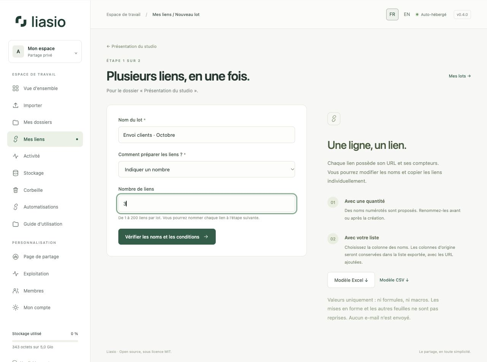
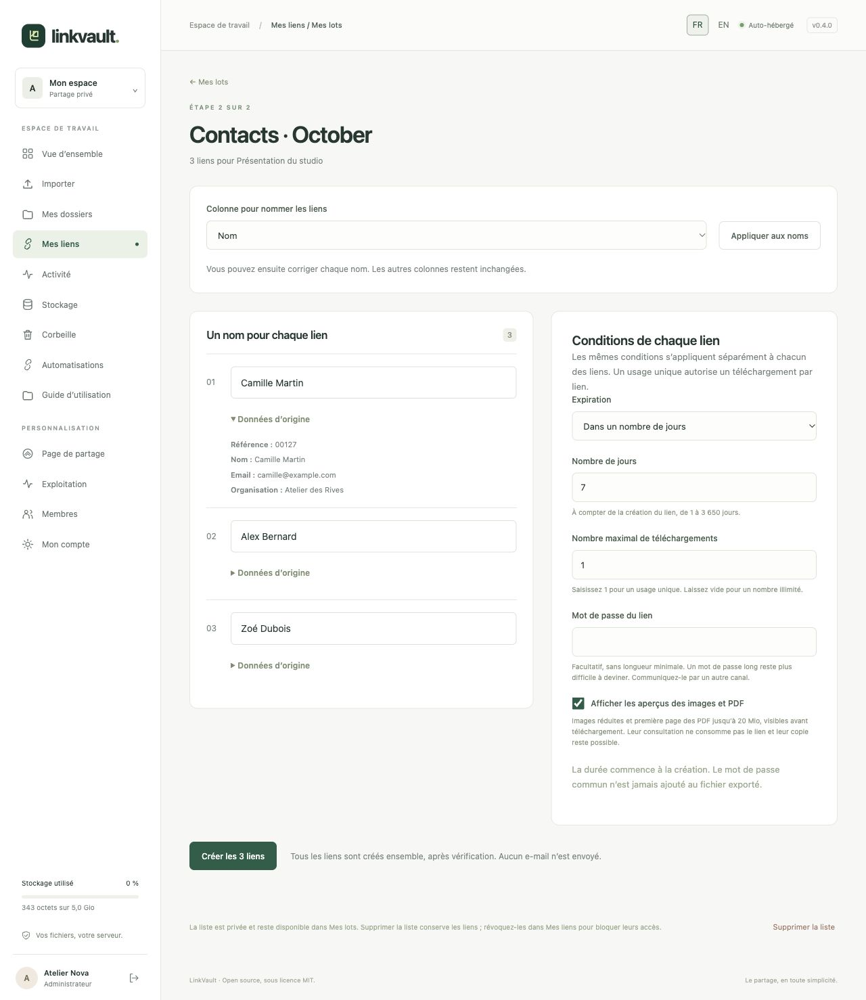
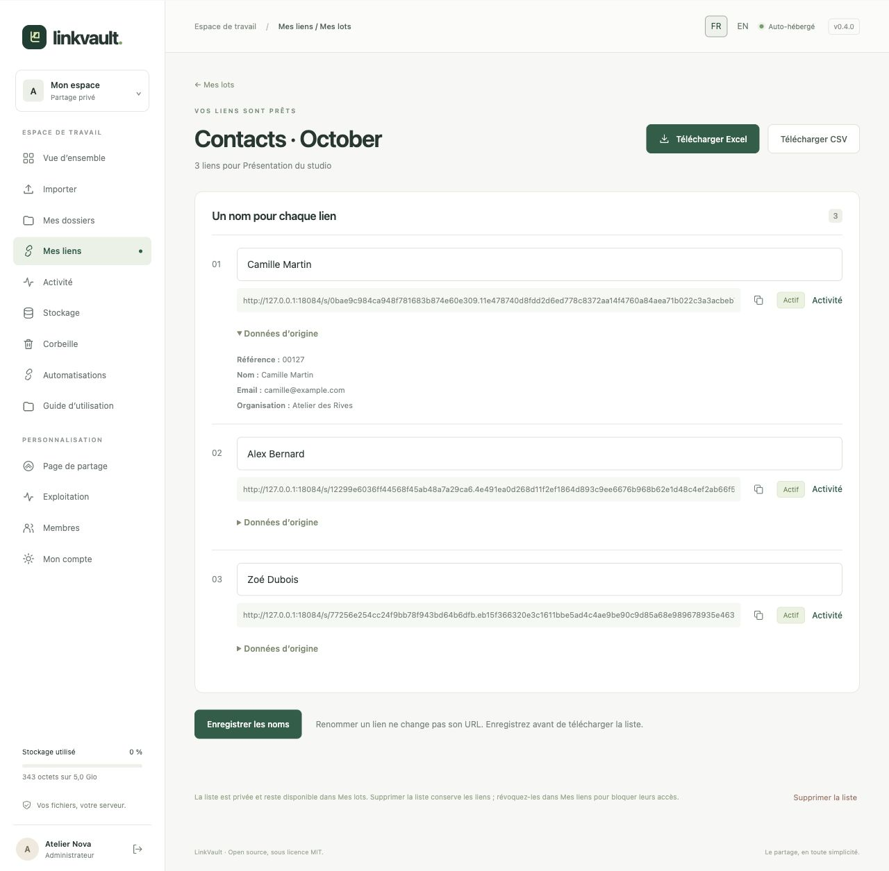

# Créer plusieurs liens sans API

Un lot génère plusieurs liens indépendants pour **un même dossier**. Chaque lien possède son URL, ses compteurs et son historique. Aucun courriel n’est envoyé : utilisez les liens individuellement ou la liste exportée dans votre outil habituel.

## 1. Choisir le dossier et préparer la liste

Depuis un dossier contenant des fichiers, cliquez sur **Créer plusieurs liens**. Vous pouvez aussi ouvrir **Mes liens → Mes lots**, choisir le dossier et cliquer sur **Préparer un lot**.

Donnez un **Nom du lot**, qui vous permettra de retrouver la liste.

- **Indiquer un nombre** : saisissez une quantité entre 1 et 200. Des noms `Lien 001`, `Lien 002`… sont proposés à l’étape suivante. Le champ ne change pas avec la molette.
- **Importer une liste Excel ou CSV** : choisissez un fichier `.xlsx` ou `.csv` UTF-8. Les boutons **Modèle Excel** et **Modèle CSV** fournissent une liste d’exemple avec les colonnes Nom, Email et Référence. Remplacez les exemples par vos lignes avant d’importer.

Chaque ligne non vide après l’en-tête correspond à un nouveau lien. Les lignes restent dans leur ordre d’origine, même si plusieurs portent le même nom. Les colonnes supplémentaires, comme une adresse e-mail ou une référence client, sont conservées pour l’export ; elles ne déclenchent aucun envoi.

Cliquez sur **Vérifier les noms et les conditions**. À ce stade, aucun lien n’est encore créé.

## 2. Vérifier et créer

Pour une liste importée, choisissez la **Colonne pour nommer les liens** puis **Appliquer aux noms**. Vous pouvez ensuite corriger chaque nom, limité à 80 caractères. Les noms sont privés, visibles uniquement par vous. **Données d’origine** permet de vérifier le contenu de chaque ligne.

Les conditions choisies sont appliquées séparément à chaque lien : expiration à une date ou après un nombre de jours, nombre maximal de téléchargements, mot de passe commun facultatif et aperçus. Par exemple, un lot de 20 liens avec une limite de `1` autorise un téléchargement par lien, soit au maximum 20 téléchargements. La durée commence à la création, pas à l’import de la liste.

Cliquez sur **Créer les X liens**. La création est atomique : tous les liens sont créés ensemble ou aucun ne l’est. Répéter la soumission de ce même brouillon ne crée pas de doublons. Préparer un nouveau lot avec le même fichier crée en revanche de nouveaux liens.

## 3. Utiliser les liens et télécharger la liste

Copiez une URL avec son bouton, ou téléchargez l’ensemble via **Télécharger Excel** / **Télécharger CSV**. La liste comprend les colonnes importées puis le nom actuel, l’URL, le statut, les dates UTC et les compteurs Liasio. Les liens sont cliquables dans le fichier Excel.

Les cellules sont exportées comme valeurs, sans formules, macros, styles ou feuilles supplémentaires du classeur d’origine. Les identifiants saisis comme texte, par exemple `00127`, restent du texte. Le CSV utilise UTF-8 avec BOM et le point-virgule ; les cellules susceptibles d’être interprétées comme des formules reçoivent une apostrophe de protection. **Le mot de passe défini dans les conditions n’est jamais exporté** : communiquez-le séparément.

Renommez les liens directement dans le lot, cliquez sur **Enregistrer les noms**, puis exportez à nouveau. Vous pouvez également utiliser **Renommer** dans **Mes liens**. L’URL et les conditions restent identiques. L’export reflète l’état des liens au moment du téléchargement ; un fichier déjà téléchargé ne se met pas à jour automatiquement.

## Retrouver ou supprimer une liste

Les lots sont accessibles dans **Mes lots**. Les brouillons expirent après 24 heures. Jusqu’à 100 lots sont conservés par compte ; **Supprimer la liste** efface ses données et son association aux liens, mais les liens restent utilisables et visibles dans **Mes liens**. Pour bloquer un lien, utilisez **Révoquer**. Une suppression de liste n’efface pas les sauvegardes déjà réalisées, qui suivent leur propre durée de conservation.

Les listes sont privées au compte qui possède le dossier, ne sont jamais affichées aux destinataires et sont incluses dans la sauvegarde de la base. Les mettre dans la corbeille avec leur dossier bloque leur accès jusqu’à restauration ; la purge du dossier les supprime.

## Formats et limites

- 1 Mio par fichier, 200 lignes de données, 20 colonnes et 1 000 caractères par cellule ; contenu textuel total limité à 256 Kio.
- En-têtes uniques et non vides, de 80 caractères maximum. Les lignes entièrement vides sont ignorées.
- Seule la première feuille Excel est importée. Utilisez de préférence un classeur contenant uniquement votre tableau : les limites de sécurité s’appliquent à tout le fichier.
- Les fichiers `.xls`, `.xlsm`, chiffrés, les formules et les références à d’autres classeurs ne sont pas acceptés. Dans Excel, utilisez **Copier → Collage spécial → Valeurs**, puis enregistrez en `.xlsx`.
- Dix préparations de lot par heure et par compte ; les limites de requêtes s’appliquent aussi par adresse IP. Si une limite est atteinte, réessayez plus tard.
- L’antivirus doit accepter la liste et les fichiers du dossier quand il est requis sur l’instance. Les données de liste utilisent la base avec leurs propres limites ; elles ne sont pas décomptées du quota de fichiers.

## Automatiser ce parcours

La [création de lots par API](bulk-links-api.md) permet d’envoyer des noms ou une quantité depuis Codex, un terminal ou le serveur d’un site, puis de récupérer les liens et les exports Excel/CSV. Ces lots apparaissent dans **Mes lots** et restent accessibles dans l’interface.

[Conditions des liens](sharing.md) · [Automatisations API et webhooks](automation.md) · [Retour au guide](README.md)
