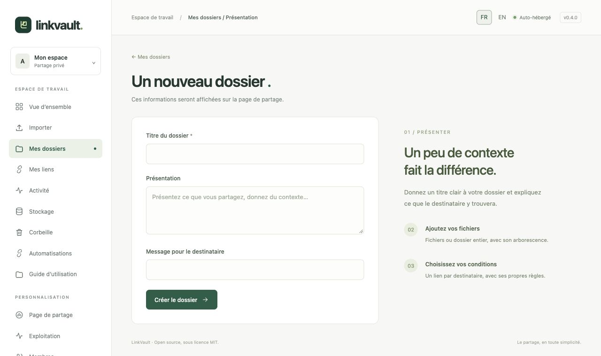
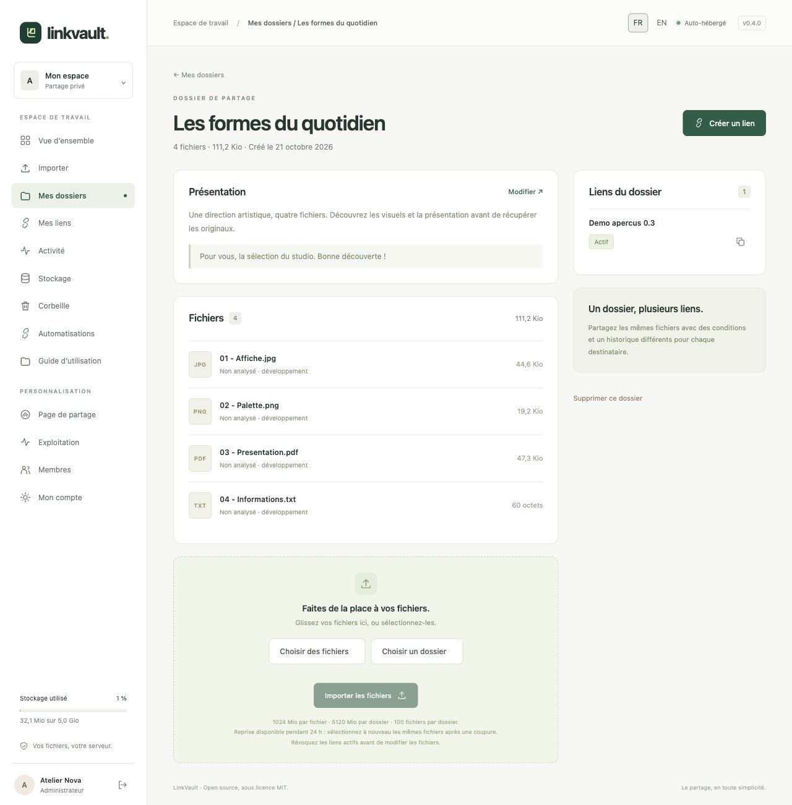

# Organiser ses dossiers

Un dossier regroupe des fichiers, une présentation destinée au destinataire et un ou plusieurs liens. Chaque membre possède sa propre bibliothèque.

## Créer un dossier

1. Ouvrez **Mes dossiers → Nouveau dossier** (également accessible depuis la vue d’ensemble).
2. Indiquez un **Titre du dossier** clair : il devient le titre de la page destinataire.
3. Ajoutez une **Présentation** du contenu et, si nécessaire, un court **Message pour le destinataire**. Ces champs sont facultatifs. Le texte est affiché sans être exécuté comme du HTML.
4. Cliquez sur **Créer le dossier**, puis [importez vos fichiers](uploads.md).

## Retrouver et modifier un dossier

Dans **Mes dossiers**, recherchez un titre puis ouvrez le dossier. Sa fiche présente les textes, les chemins, les tailles, le statut antivirus et les liens existants. **Modifier** permet de changer la présentation. Les nouveaux textes sont visibles sur les liens existants.

Pour modifier les fichiers, révoquez d’abord tous les liens actifs : un dossier déjà partagé doit garder un contenu cohérent. Un dossier peut contenir jusqu’à 100 fichiers, y compris ceux encore dans la corbeille ; les limites de taille dépendent du serveur.

## Supprimer un dossier

Cliquez sur **Supprimer ce dossier**, vérifiez la confirmation puis placez-le dans la corbeille. Tous ses liens sont révoqués et les envois en attente annulés. Les fichiers restent récupérables pendant la durée configurée (30 jours par défaut) et comptent encore dans le quota. Consultez le [guide du stockage et de la corbeille](storage.md) pour les restaurer ou les supprimer définitivement.

## Créer un autre lien

Une fois les fichiers prêts, choisissez **Créer un lien**. Vous pouvez créer plusieurs liens avec des noms, mots de passe, expirations et limites différents sans dupliquer les fichiers. Voir [Partage](sharing.md).
