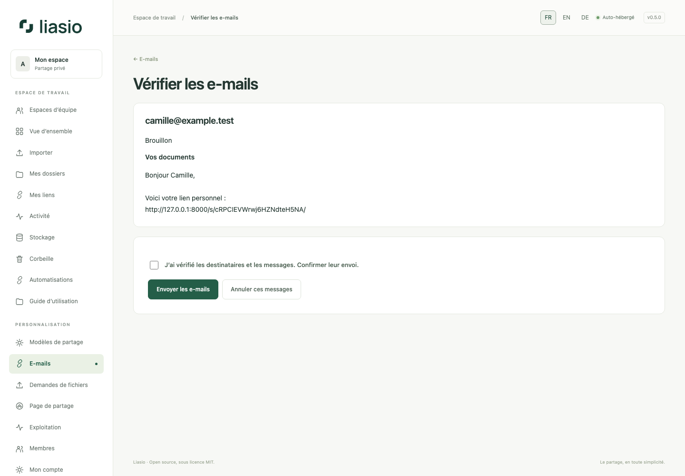

# E-mails validés et destinataires vérifiés

## Préparer et envoyer

1. Configurez SMTP et démarrez le service `mail`. L’administrateur peut demander un message à sa propre adresse depuis **Exploitation → Diagnostic de configuration**, puis consulter son état dans **E-mails**.
2. Depuis **Mes liens**, un lot terminé ou une invitation, choisissez **Préparer un e-mail / les e-mails**. La colonne `Email`/`E-mail`/`Courriel` d’un lot préremplit les adresses : vérifiez-les toutes. Une invitation reste réservée à son adresse d’origine.
3. Choisissez un modèle ou rédigez objet et message. Variables : `$name`, `$link`, `$collection` ; `$$` affiche un dollar. Les mots de passe des liens ne sont jamais ajoutés automatiquement. Transmettez-les séparément.
4. Cliquez sur **Prévisualiser les messages**, relisez chaque brouillon personnalisé, cochez la confirmation puis **Envoyer les e-mails**. Créer des liens ou consulter un brouillon n’envoie rien. Les brouillons expirent après 24 heures.
5. **E-mails** affiche attente, envoi, acceptation SMTP, échec et annulation. Vous pouvez annuler un brouillon ou ses messages encore en attente depuis sa page de validation. Un message déjà en cours ou accepté ne peut pas être rappelé.

Limite : 1 000 messages actifs par expéditeur, un envoi simultané par compte, reprises bornées et répartition équitable. Droits et disponibilité du lien sont revérifiés avant l’envoi. L’acceptation SMTP ne prouve ni réception ni lecture ; une panne après acceptation peut entraîner un doublon avec le même Message-ID. Métadonnées conservées 30 jours ; contenu privé chiffré puis effacé après traitement/annulation.

Les modèles et notifications facultatives se règlent dans **E-mails**. Les notifications de téléchargement signalent une autorisation, pas la réception complète. Désactivées par défaut, elles sont limitées à dix par heure.

## Vérifier la boîte e-mail

Dans **Destinataires autorisés** d’un nouveau lien, saisissez une adresse par ligne (100 maximum). Le visiteur doit recevoir et saisir un code à six chiffres avant d’accéder à la page, aux aperçus ou au téléchargement. SMTP est obligatoire. Code valable dix minutes, cinq essais, lié à ce navigateur et à ce lien. La validation dure une heure ; le mot de passe éventuel reste également exigé.

Pour un lot importé, choisissez la colonne e-mail et **Vérifier l’adresse e-mail de chaque ligne** : chaque lien est réservé à son destinataire. L’API accepte `recipients: [{"name":"A","email":"alex@example.test"}]` et `verify_recipients: true`. Sans vérification, la colonne e-mail sert seulement à préparer les messages et ne limite pas l’accès. Voir [les lots API](bulk-links-api.md).
