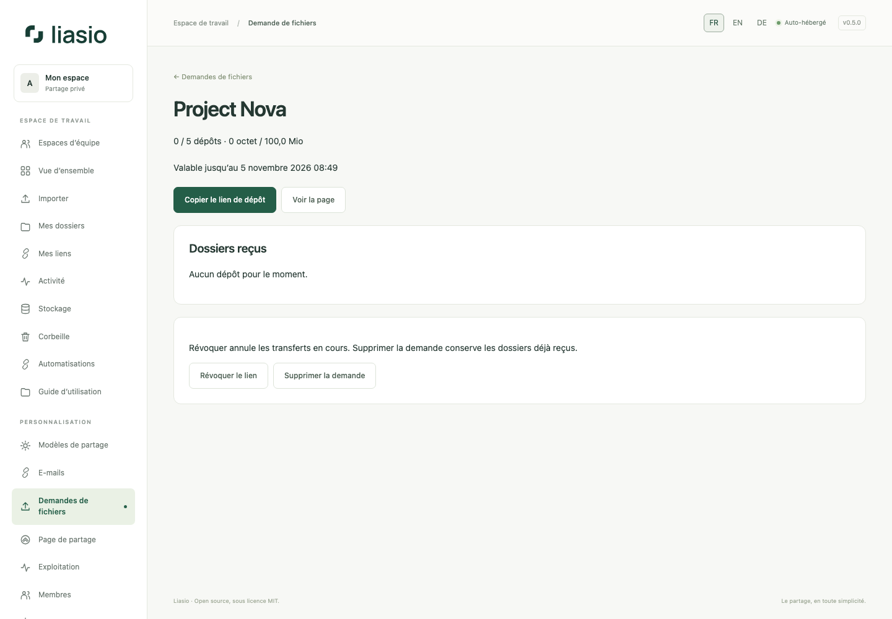

# Recevoir les fichiers d’un client

1. Dans **Demandes de fichiers**, indiquez titre et instructions, puis validité (1–365 jours), volume total en Mio et nombre maximal de dépôts (1–200). Le volume ne peut dépasser votre quota. Limite : 100 demandes conservées par compte.
2. Créez la demande et copiez son lien privé de dépôt. Transmettez-le aux personnes prévues : tout détenteur peut utiliser le volume restant. Il ne donne aucun accès au compte ni aux autres dépôts.
3. Le client ajoute fichiers et/ou dossiers puis démarre l’envoi. Progression réelle, pause/reprise, contrôle d’intégrité et antivirus utilisent le même circuit sécurisé. JavaScript est nécessaire. La reprise demande le même navigateur et les mêmes fichiers sous 24 heures, tant que la demande reste active.
4. Chaque dépôt crée un dossier privé distinct dont vous êtes propriétaire. Les dépôts terminés apparaissent dans **Dossiers reçus** : ouvrez-les pour contrôler les fichiers puis créer, si besoin, des liens de partage habituels. Un dossier vide peut rester après annulation et se supprime normalement.
5. **Révoquer** bloque les nouveaux dépôts et annule les imports en attente, en libérant leurs réservations. **Supprimer la demande** retire aussi la demande ; les dossiers reçus restent conservés. L’expiration bloque les écritures suivantes et la maintenance libère les sessions d’import expirées.

Les plafonds de la demande comptent les dépôts terminés et les réservations en cours sur toute sa durée. Supprimer des fichiers reçus ne reconstitue pas ces plafonds. Quota du compte, tailles maximales, limite de cinq imports en attente et capacité disque continuent de s’appliquer. Les noms proviennent du client ; le dépôt ne vérifie pas son identité. Aucun visiteur ne peut consulter ou reprendre le dépôt d’un autre navigateur. En production, un échec antivirus empêche la publication ; ne désactivez pas l’analyse pour accepter un fichier refusé.

Activez éventuellement les notifications depuis [E-mails](email.md) et gérez les fichiers depuis [Stockage](storage.md).
