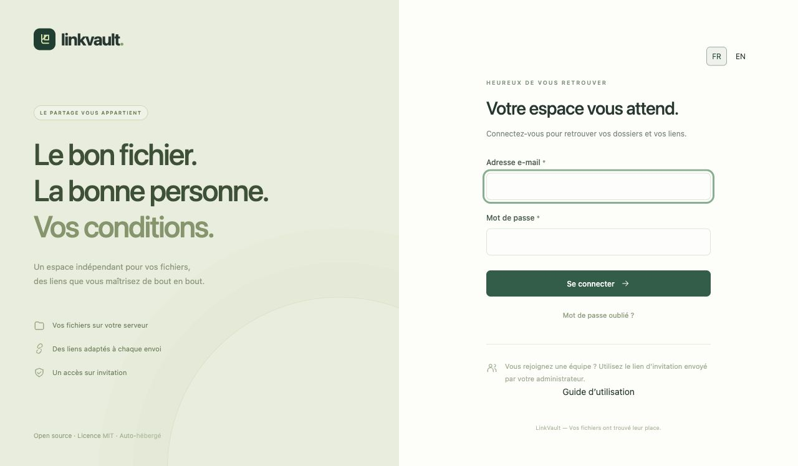
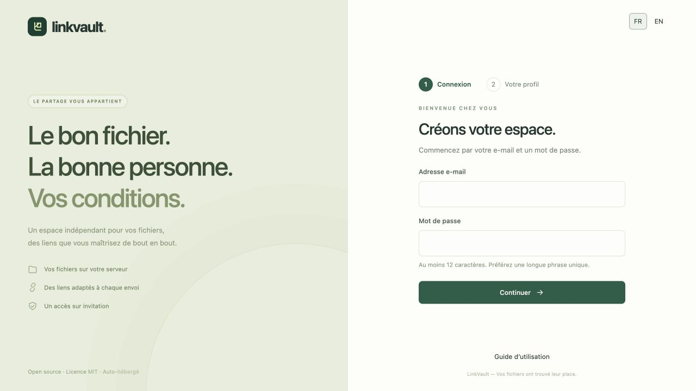
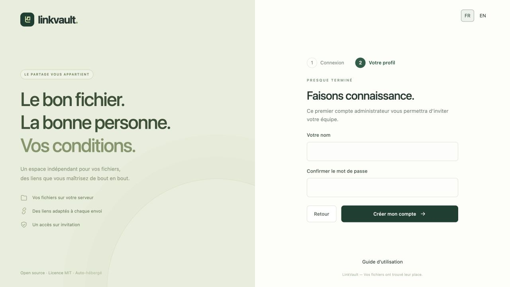

# Premiers pas avec LinkVault

LinkVault est installé sur votre serveur. Ouvrez son adresse HTTPS pour créer le premier compte sur une instance neuve. Une fois l’installation terminée, une invitation personnelle est nécessaire pour rejoindre l’espace. Un lien de partage donne accès à un dossier ; ce n’est pas une invitation à créer un compte.

## Installer et créer le premier administrateur

1. Suivez les [instructions d’installation](../../../README.fr.md) sur un serveur avec domaine et HTTPS. Consultez le [guide d’exploitation](../../OPERATIONS.md) pour la production.
2. Ouvrez votre instance. Sur une installation neuve, la page **Première installation** apparaît automatiquement.
3. Saisissez votre e-mail et un mot de passe unique d’au moins 12 caractères, puis cliquez sur **Continuer**. Aucune clé d’installation n’est nécessaire.
4. Renseignez votre nom et confirmez le mot de passe, puis cliquez sur **Créer mon compte**. **Retour** permet de modifier votre e-mail ou votre mot de passe sans perdre la saisie. Le compte n’est créé qu’à cette dernière validation.
5. La première personne qui termine l’installation devient administrateur : terminez cette étape avant de diffuser l’adresse de l’instance. L’assistant se ferme ensuite et les comptes suivants nécessitent une invitation. Conservez la configuration du serveur et les moyens de récupération en lieu sûr.

Les deux étapes courtes tiennent sur les écrans habituels d’ordinateur et de téléphone. Dans une fenêtre plus petite, avec du texte agrandi ou des erreurs de validation, la page peut défiler pour garder tous les contrôles accessibles. Sans JavaScript, les champs apparaissent ensemble et la création du compte fonctionne toujours. Si la validation serveur refuse l’envoi, ressaisissez les mots de passe : ils ne sont jamais renvoyés dans la page.

## Accepter une invitation

Ouvrez le lien personnel transmis par l’administrateur. Vérifiez l’e-mail affiché, choisissez votre nom et votre mot de passe puis créez votre compte. Une invitation est valable sept jours et une seule fois. Demandez-en une nouvelle si elle a expiré. Voir [Membres](team.md).

## Se connecter, choisir sa langue et se déconnecter

Utilisez votre e-mail et votre mot de passe. Si la double authentification est activée, saisissez un nouveau code de votre application ou un code de récupération. Le sélecteur **FR / EN** est disponible sur les pages de connexion, dans l’espace de travail et sur les pages destinataires. Le choix est mémorisé dans un cookie du navigateur ; sans choix explicite, la langue du navigateur est utilisée, avec le français par défaut. Vos noms de fichiers et vos présentations ne sont pas traduits automatiquement.

Cliquez sur **Se déconnecter** en bas du menu, notamment sur un ordinateur partagé. Mot de passe oublié ? Consultez la [récupération du compte](account.md). L’administrateur doit avoir configuré l’envoi d’e-mails.

## Votre premier envoi

[Créer un dossier](collections.md) → [importer les fichiers](uploads.md) → [créer un lien](sharing.md). Vous pouvez personnaliser votre [page de partage](branding.md) avant de l’envoyer.
