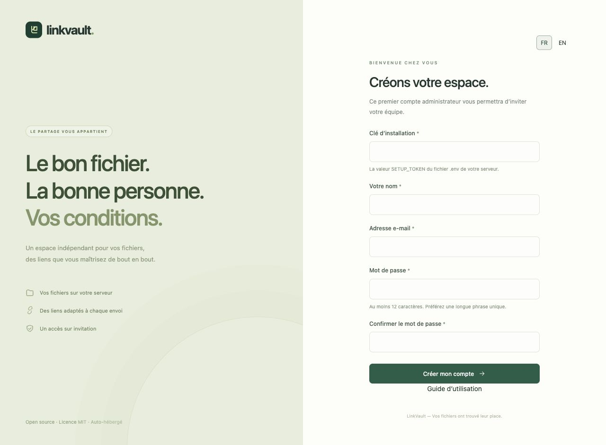

# Premiers pas avec LinkVault

LinkVault est installé sur votre serveur. Il vous faut son adresse HTTPS et soit la clé d’installation, soit une invitation personnelle. Un lien de partage donne accès à un dossier ; ce n’est pas une invitation à créer un compte.

## Installer et créer le premier administrateur

1. Suivez les [instructions d’installation](../../../README.fr.md) sur un serveur avec domaine et HTTPS. Consultez le [guide d’exploitation](../../OPERATIONS.md) pour la production.
2. Ouvrez votre instance. Sur une installation neuve, la page **Première installation** apparaît automatiquement.
3. Saisissez `SETUP_TOKEN`, présent dans le fichier privé `.env` du serveur, votre nom, votre e-mail et un mot de passe unique d’au moins 12 caractères. Confirmez-le et cliquez sur **Créer mon compte**.
4. Ce premier compte est administrateur. L’installation se ferme ensuite. Conservez la configuration du serveur et les moyens de récupération en lieu sûr.

## Accepter une invitation

Ouvrez le lien personnel transmis par l’administrateur. Vérifiez l’e-mail affiché, choisissez votre nom et votre mot de passe puis créez votre compte. Une invitation est valable sept jours et une seule fois. Demandez-en une nouvelle si elle a expiré. Voir [Membres](team.md).

## Se connecter, choisir sa langue et se déconnecter

Utilisez votre e-mail et votre mot de passe. Si la double authentification est activée, saisissez un nouveau code de votre application ou un code de récupération. Le sélecteur **FR / EN** est disponible sur les pages de connexion, dans l’espace de travail et sur les pages destinataires. Le choix est mémorisé dans un cookie du navigateur ; sans choix explicite, la langue du navigateur est utilisée, avec le français par défaut. Vos noms de fichiers et vos présentations ne sont pas traduits automatiquement.

Cliquez sur **Se déconnecter** en bas du menu, notamment sur un ordinateur partagé. Mot de passe oublié ? Consultez la [récupération du compte](account.md). L’administrateur doit avoir configuré l’envoi d’e-mails.

## Votre premier envoi

[Créer un dossier](collections.md) → [importer les fichiers](uploads.md) → [créer un lien](sharing.md). Vous pouvez personnaliser votre [page de partage](branding.md) avant de l’envoyer.
