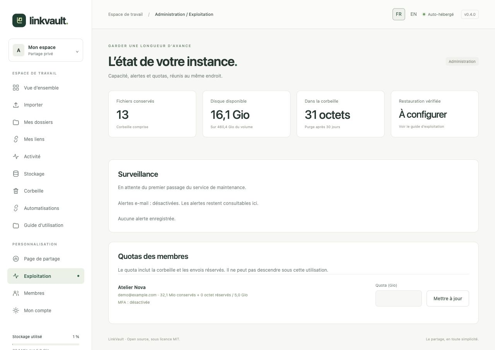

# Administrer son instance

La page **Exploitation** est réservée aux administrateurs. Elle réunit le nombre de fichiers conservés, l’espace disque, la corbeille, la vérification des restaurations, les contrôles de base/antivirus et les alertes.

## Régler le quota d’un membre

Dans **Quotas des membres**, indiquez une taille en Gio puis cliquez sur **Mettre à jour**. Un Gio représente 1 073 741 824 octets. Le quota ne peut pas descendre sous les fichiers, la corbeille et les envois réservés. L’augmenter ne crée pas d’espace disque : vérifiez d’abord la capacité disponible.

## Traiter une alerte

- **Disque saturé :** supprimez les fichiers inutiles, purgez la corbeille après vérification ou agrandissez le volume. Gardez de l’espace pour les envois temporaires et les téléchargements ZIP.
- **Antivirus indisponible :** contrôlez ClamAV et ses mises à jour de signatures. En production, les imports sont bloqués tant qu’il est indisponible.
- **Maintenance absente :** vérifiez le conteneur de maintenance. Il purge les envois expirés, la corbeille, les sessions et les anciens événements.
- **Restauration trop ancienne :** réalisez une sauvegarde et un véritable test de restauration ; déclarer une sauvegarde réussie sans la restaurer ne suffit pas.

Les alertes e-mail nécessitent SMTP et `MONITOR_EMAIL`. Elles restent visibles dans l’interface même sans envoi d’e-mails. Les réservations de quota et la réserve disque minimale s’appliquent aussi à l’API.

## Sauvegarder, mettre à jour et livrer les webhooks

Le [guide d’exploitation](../../OPERATIONS.md) détaille les sauvegardes, tests de restauration, mises à jour, contrôles et effacements de comptes. Conservez les clés de chiffrement du `.env` avec les sauvegardes de base et de fichiers ; leur perte ou modification peut invalider la MFA et les secrets d’intégration.

Compose inclut un service `webhooks`. Démarrez ou mettez à jour la pile complète avec `docker compose up -d --build`. Pour une installation manuelle, exécutez `python manage.py deliver_webhooks --loop` avec un superviseur. Il doit accéder à la base et aux destinataires HTTPS publics. La page Automatisations signale l’absence de son activité récente.

L’historique des livraisons est conservé 30 jours et nettoyé par la maintenance. Cette version ne s’installe pas automatiquement sur un VPS : configurez le domaine, HTTPS, la capacité et les sauvegardes avant l’exposition publique.
