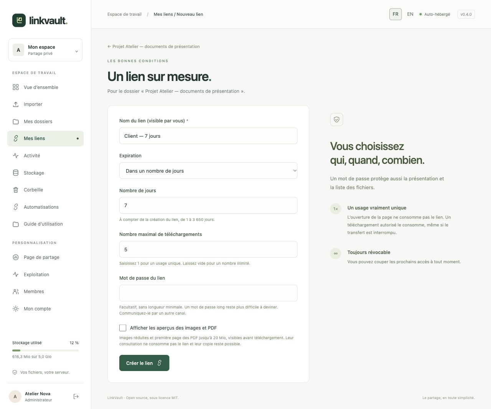
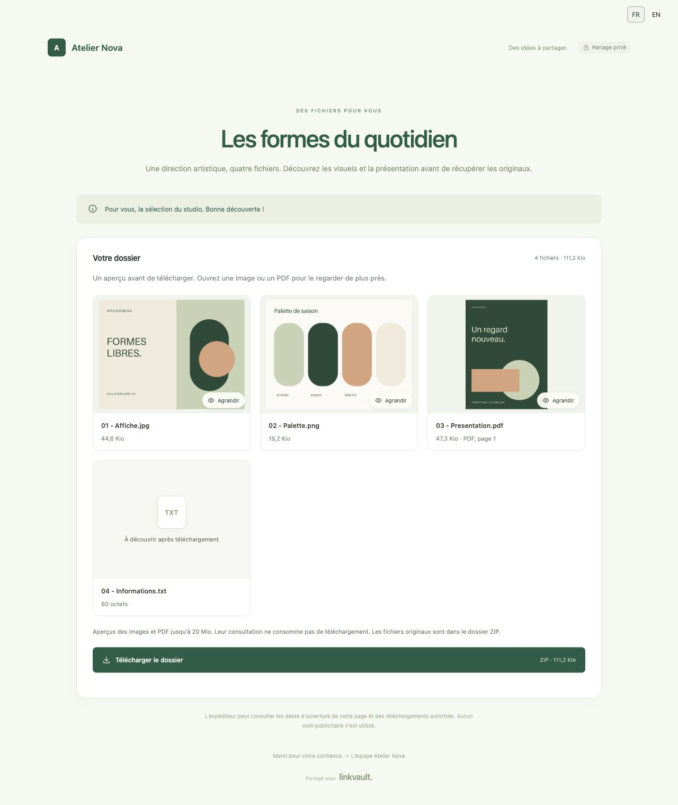
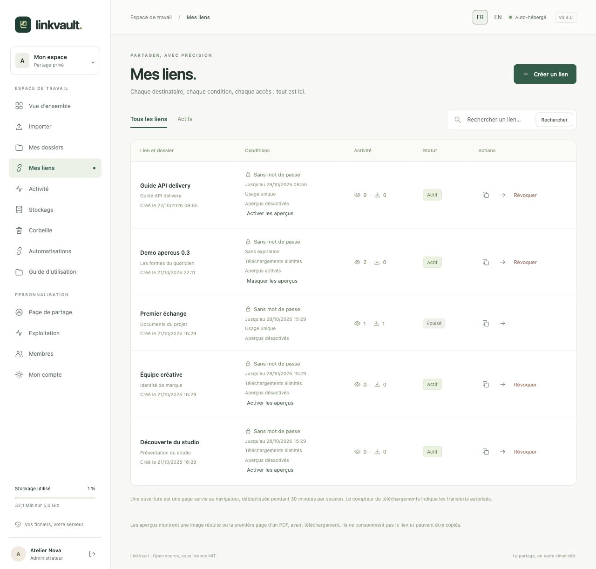

# Liens de partage et aperçus

Pour créer plusieurs liens à la fois, par quantité ou depuis Excel/CSV, consultez le [guide des liens en lot](bulk-links.md). Le bouton **Renommer** permet aussi de changer le nom d’un lien existant sans modifier son URL ni ses conditions.

## Créer un lien avec vos conditions

Ouvrez un dossier contenant des fichiers puis cliquez sur **Créer un lien**.

| Champ | Utilisation |
| --- | --- |
| Nom du lien | Une étiquette privée pour identifier le destinataire ou l’automatisation. |
| Expiration | **Sans expiration**, **À une date précise**, ou **Dans un nombre de jours** (1 à 3 650 à compter de la création ; 7 jours par défaut). La date utilise le fuseau de l’instance, Europe/Berlin par défaut. |
| Nombre maximal de téléchargements | `1` pour un usage unique ; vide pour illimité. Valeur maximale : 100 000. Le champ ne change pas avec la molette. |
| Mot de passe du lien | Facultatif, sans minimum, 128 caractères maximum. Une phrase longue est plus difficile à deviner. Transmettez-le par un autre canal. |
| Aperçus des images et PDF | Facultatifs. Activés par défaut dans le formulaire de création ; désactivés par défaut dans l’API. |

Cliquez sur **Créer le lien**. Dans **Mes liens**, copiez l’URL et transmettez-la au destinataire. Le mot de passe protège aussi la présentation et la liste des fichiers. Le destinataire n’a pas besoin d’un compte Liasio.

Les URL de partage utilisent désormais un jeton signé compact de 43 caractères après `/s/`, contre 97 auparavant. Les liens existants adoptent aussi ce format lorsque vous les recopiez ; **les anciennes URL fonctionnent toujours**. Les deux adresses désignent le même lien : mot de passe, expiration, révocation, activité et nombre de téléchargements sont communs. Les exports de lots et les nouvelles réponses API utilisent également l’URL compacte ; refaites un export pour actualiser un fichier Excel déjà téléchargé. Une nouvelle tentative API peut renvoyer son URL longue d’origine, qui reste valable. Voir le [format et la compatibilité des liens](../../SHARE_LINKS.md).

## Voir ce que découvre le destinataire

La liste montre les dossiers et sous-dossiers dépliables, dans leur ordre d’ajout. Avec les aperçus activés, ouvrez **Voir les aperçus des fichiers** : les JPEG, PNG, WebP et GIF (première image), ainsi que les PDF (première page), se consultent avant téléchargement. L’original doit peser au maximum 20 Mio ; les images sont limitées à 24 mégapixels. Les aperçus sont des JPEG réduits et sans métadonnées. Les autres formats affichent leur nom, leur type et leur taille. Un aperçu indisponible n’empêche pas le téléchargement autorisé de l’original.

Cliquez sur une miniature pour l’agrandir. Utilisez les boutons précédent/suivant ou les flèches du clavier ; Échap ferme la fenêtre. Les aperçus exigent le même mot de passe et un lien valide. Ils ne consomment pas de téléchargement, mais restent copiables. Voir le [fonctionnement technique](../../PREVIEWS.md).

## Gérer ou révoquer un lien

Dans **Mes liens**, recherchez, filtrez les liens actifs, activez ou masquez les aperçus, consultez les compteurs ou cliquez sur **Révoquer**. Confirmez pour bloquer les prochains accès. Pour changer un mot de passe, une expiration ou une limite, créez un nouveau lien et révoquez l’ancien.

L’ouverture d’une page ne consomme pas un lien à usage unique. Un téléchargement ZIP autorisé le consomme, même interrompu. Un lien révoqué, expiré ou épuisé ne peut plus démarrer un téléchargement ; un transfert déjà en cours peut se terminer. La révocation n’efface pas les copies déjà téléchargées.
