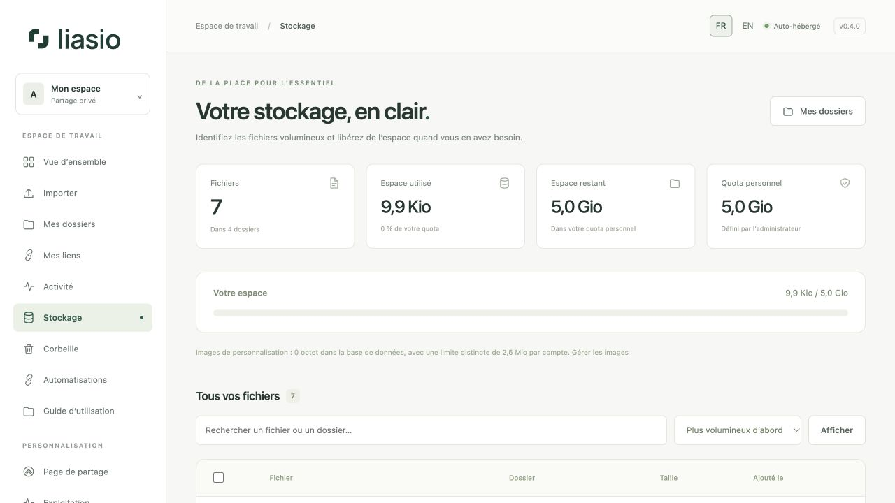
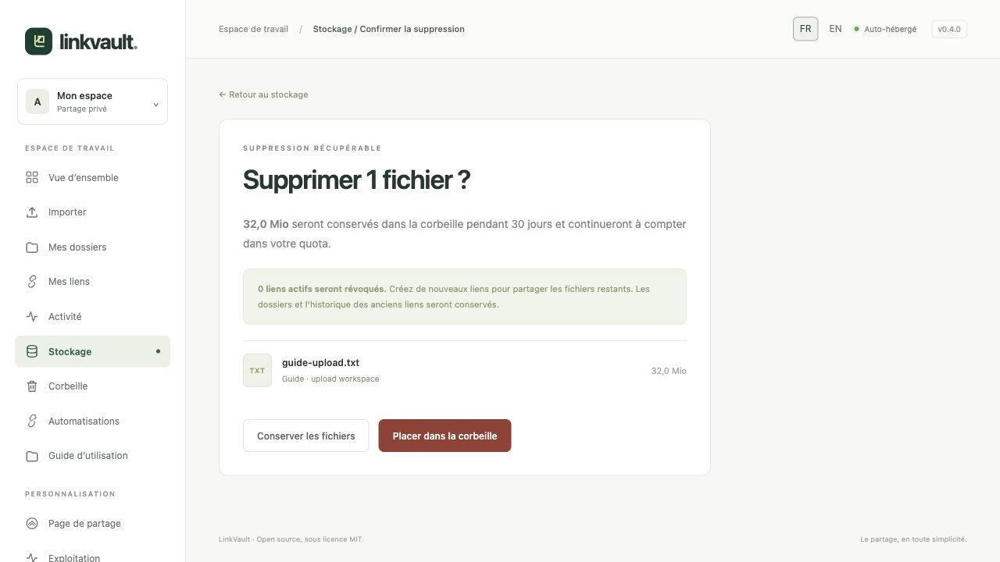
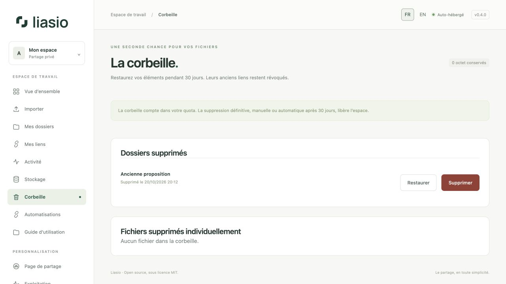

# Stockage, corbeille et suppressions

## Comprendre l’utilisation

Ouvrez **Stockage** pour voir le nombre de fichiers, l’espace utilisé, le quota restant et une liste avec recherche. Triez par taille décroissante, croissante, date ou nom. Les administrateurs voient aussi l’utilisation du disque du serveur et par compte.

Cette page mesure le **stockage disque**, pas la consommation de mémoire vive. Le quota inclut les fichiers conservés et la corbeille. Les envois en attente réservent de l’espace supplémentaire. L’espace disque du serveur inclut toutes les applications et les ZIP temporaires : il peut différer du total des fichiers Liasio.

## Supprimer une sélection

1. Recherchez ou triez les fichiers. Cochez les lignes individuellement ou toutes les lignes **de la page actuelle**, pas tous les résultats.
2. Cliquez sur **Examiner la suppression**. Vérifiez le nombre de fichiers, la taille totale et les liens concernés.
3. Confirmez **Placer dans la corbeille**. Les liens des dossiers concernés sont révoqués. Le reste de chaque dossier reste disponible dans votre espace ; créez de nouveaux liens pour le partager.

## Restaurer ou supprimer définitivement

Ouvrez **Corbeille**. Les dossiers entiers et les fichiers supprimés individuellement sont séparés. **Restaurer** remet un élément dans votre bibliothèque ; ses anciens liens restent révoqués. Un fichier situé dans un dossier supprimé se restaure avec ce dossier.

Pour libérer immédiatement le quota, choisissez **Supprimer définitivement**, vérifiez puis confirmez. Les originaux conservés sont effacés ; cette action ne s’annule pas depuis Liasio. Sinon, la maintenance purge après la durée configurée (30 jours par défaut). Restaurer un dossier ne restaure que les fichiers supprimés avec lui ; les fichiers supprimés auparavant restent dans la corbeille.

Pour un quota plus élevé, demandez à l’administrateur de le modifier dans [Exploitation](operations.md). Vider la corbeille ne corrige pas la consommation d’une autre application : une saturation générale nécessite une intervention sur le serveur.

## Versions et stockage objet

Les [versions](versions.md) conservées comptent aussi dans le quota. Remplacer un document peut donc augmenter l’utilisation sans changer le nombre de fichiers actuels. Supprimez les versions obsolètes avant de purger leurs fichiers référencés ; les anciennes copies sans référence sont supprimées après le délai de conservation. Avec le [stockage S3](advanced-operations.md), le quota compte les originaux stockés tandis que les chiffres du disque concernent les imports et archives temporaires locaux : ce sont deux ressources distinctes.
