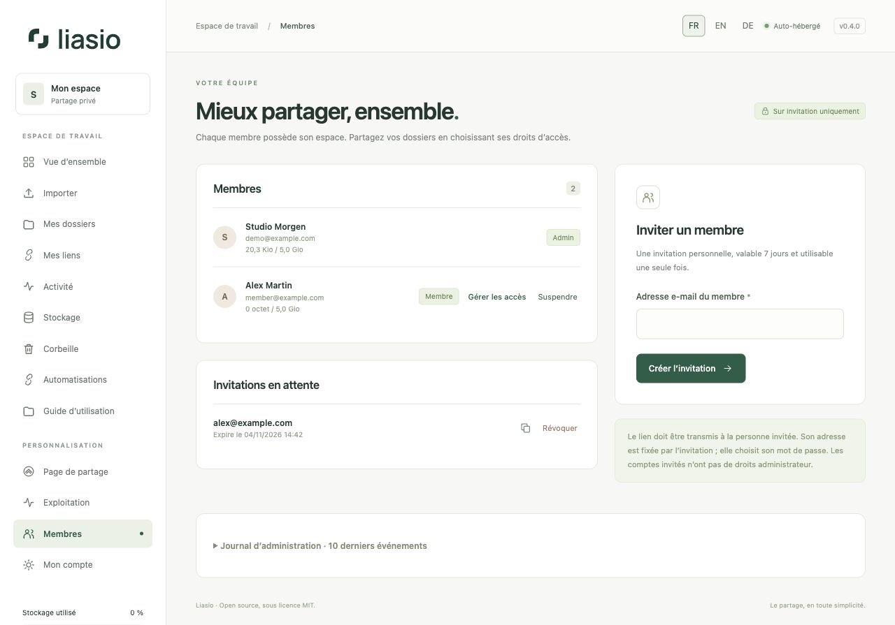
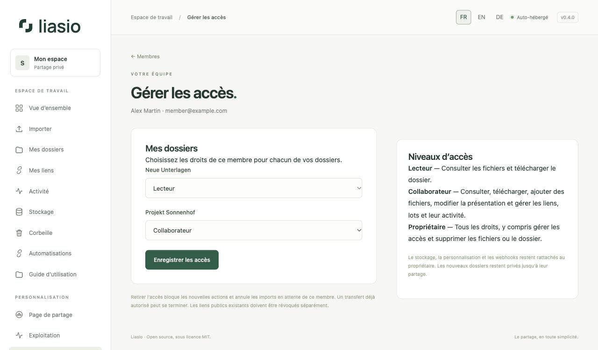

# Inviter et gérer les membres

Une invitation crée un compte personnel. **Elle ne partage pas automatiquement vos dossiers.** Un administrateur peut inviter et suspendre les membres, mais ce rôle ne donne pas accès aux fichiers privés d’un autre compte.

## Inviter un membre

1. Dans **Membres**, saisissez son e-mail puis cliquez sur **Créer l’invitation**.
2. Copiez le lien et transmettez-le à la personne. Liasio n’envoie pas automatiquement d’e-mail.
3. Le destinataire choisit son nom et son mot de passe. Son adresse est fixée par l’invitation ; il ne devient pas administrateur.
4. Une fois l’invitation acceptée, attribuez les accès aux dossiers comme ci-dessous.

L’invitation expire après sept jours et s’accepte une seule fois. Une adresse déjà inscrite ne peut pas être invitée à nouveau. **Révoquer** annule une invitation inutilisée ; créez-en une nouvelle pour remplacer une invitation expirée.

## Donner accès aux dossiers

Dans **Membres**, cliquez sur **Gérer les accès** à côté du membre. Choisissez un niveau pour chacun de **vos** dossiers, puis **Enregistrer les accès**. Les dossiers privés des autres propriétaires ne sont pas proposés.

| Niveau | Actions autorisées |
| --- | --- |
| Aucun accès | Le dossier reste invisible. |
| Lecteur | Voir la présentation et l’arborescence, télécharger les fichiers en ZIP. Les liens de destinataires, lots et historiques ne sont pas accessibles. |
| Collaborateur | Droits du lecteur, plus ajout de fichiers, modification de la présentation, création et gestion des liens et lots, exports et consultation de leur activité. |
| Propriétaire | Tous les droits, dont gestion des accès, suppression des fichiers, du dossier et gestion de la corbeille. Ce rôle correspond au créateur du dossier et ne s’attribue pas dans le menu. |

Chaque propriétaire peut aussi ouvrir un dossier et cliquer sur **Gérer les accès**, saisir l’e-mail d’un membre actif et choisir son rôle. Pour retirer le partage, choisissez **Aucun accès**. Seul le propriétaire gère ces autorisations ; un collaborateur ne peut pas partager l’accès de travail avec un autre compte.

Le membre retrouve les dossiers autorisés dans **Mes dossiers** et la vue d’ensemble, avec la mention **Partagé par**. Son rôle est indiqué dans le dossier. Il utilise son propre compte et, pour les automatisations, sa propre clé API.

Le bouton **Télécharger les fichiers** est réservé aux membres connectés et ne consomme aucune utilisation des liens destinés aux clients. Les ajouts comptent dans le quota du propriétaire ; les règles d’antivirus, de capacité et de révocation des liens actifs avant modification des fichiers restent applicables. Personnalisation et webhooks du dossier restent ceux du propriétaire ; les actions sont attribuées au membre qui les réalise.

## Retirer un accès ou changer de rôle

La modification prend effet sur les prochaines requêtes, y compris avec une clé API existante. Passer de Collaborateur à Lecteur, ou retirer l’accès, annule les imports en attente initiés par ce membre sur le dossier et libère la réservation de stockage. Un transfert déjà autorisé peut se terminer.

**Les liens publics déjà créés ne sont pas révoqués automatiquement.** Révoquez ceux qui ne doivent plus fonctionner dans **Mes liens**. Un retrait d’accès ne supprime ni les fichiers ni les copies déjà téléchargées. Les nouveaux dossiers restent privés : partagez-les explicitement lorsque nécessaire.

## Suspendre ou réactiver

Dans **Membres**, cliquez sur **Suspendre** puis confirmez. La suspension ferme ses sessions, révoque ses propres liens et clés API et met ses webhooks en pause. Ses fichiers restent conservés et comptés dans son quota. Les accès aux dossiers partagés deviennent inutilisables tant que le compte est suspendu. Les liens des dossiers appartenant à d’autres membres restent valables.

**Réactiver** permet une nouvelle connexion et rétablit l’usage des autorisations de dossiers qui n’ont pas été retirées. Les liens et clés révoqués le restent, les webhooks restent en pause. Les comptes administrateurs ne peuvent pas être suspendus depuis cette page.

## Journal et quotas

La page montre les dix derniers événements d’administration, dont les changements d’accès. Dans **Exploitation → Quotas des membres**, ajustez les limites de stockage. L’effacement définitif d’un compte est une commande serveur, documentée dans [Exploitation](../../OPERATIONS.md).
