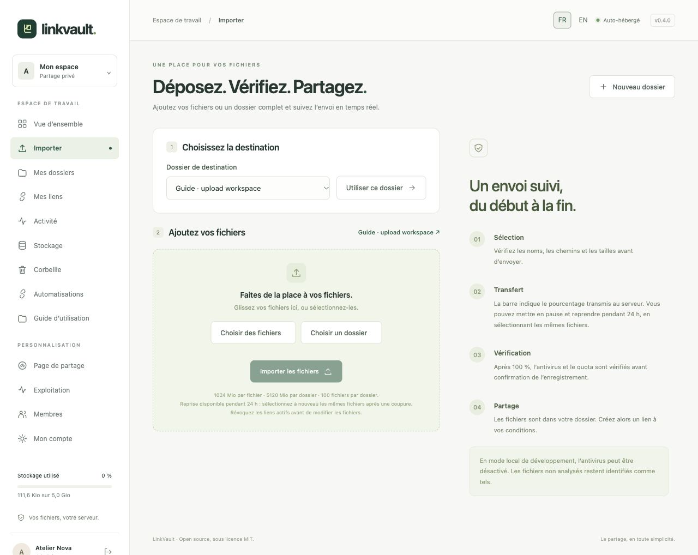
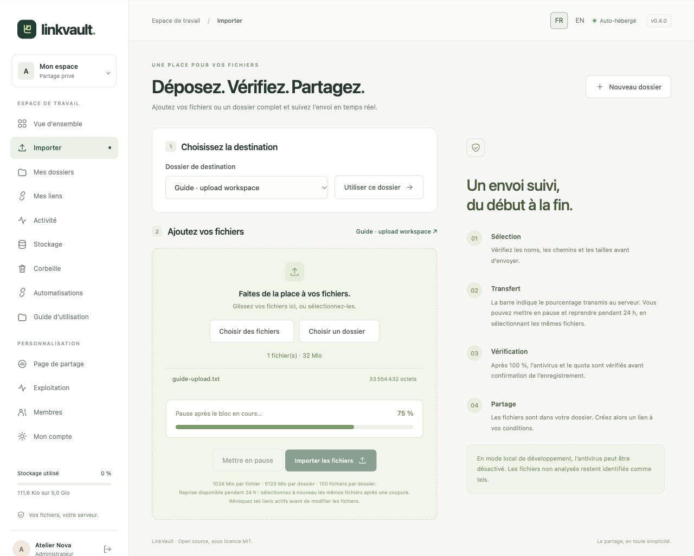

# Importer des fichiers ou un dossier

## Choisir la destination et les fichiers

1. Ouvrez **Importer**, choisissez un dossier existant puis **Utiliser ce dossier**. Créez d’abord un dossier si la liste est vide.
2. Cliquez sur **Choisir des fichiers** pour des fichiers individuels, ou **Choisir un dossier** pour une arborescence complète. Vous pouvez aussi glisser des fichiers individuels dans la zone. Utilisez le sélecteur de dossier pour conserver l’arborescence.
3. Vérifiez les chemins, les tailles et le total puis cliquez sur **Importer les fichiers**. Le navigateur peut vous demander de confirmer l’accès au dossier sélectionné.

Par défaut : 1 Gio par fichier, 5 Gio par dossier et 100 fichiers maximum. L’administrateur peut modifier les limites de taille ; les valeurs de votre instance sont affichées sur la page. Le quota personnel, la corbeille et les réservations d’envois s’appliquent aussi. Les chemins cachés, relatifs, doublons et extensions interdites sont refusés.

## Comprendre la progression et la confirmation

La barre mesure les octets reçus par le serveur, par blocs de 4 Mio avec vérification d’intégrité. **100 % ne signifie pas encore terminé** : suivent l’analyse antivirus, les contrôles de quota et l’enregistrement définitif. Une fois l’opération réussie, vous revenez au dossier et retrouvez ses fichiers. En production, un échec ou une indisponibilité de l’antivirus bloque l’import.

## Mettre en pause, reprendre ou annuler

Cliquez sur **Mettre en pause** ; le bloc en cours se termine d’abord. Après une coupure ou un rechargement, sélectionnez exactement les mêmes fichiers et cliquez sur **Importer les fichiers**. Les blocs reçus sont réutilisés pendant 24 heures. La zone des envois en attente indique la progression et propose **Annuler cet envoi**. L’annulation libère le quota réservé ; la maintenance supprime les envois expirés.

Un utilisateur peut avoir cinq envois en attente. Révoquez les liens actifs avant d’ajouter des fichiers. Si le quota ou le disque est plein, utilisez [Stockage](storage.md) ou contactez l’administrateur. En cas de refus antivirus, examinez le fichier original ; ne désactivez pas la protection pour le forcer.

Sans JavaScript, un formulaire simple pour fichiers individuels reste disponible, limité à 500 Mio par requête. La progression, les dossiers et la reprise nécessitent JavaScript. Pour les transferts automatiques, consultez l’[API](automation.md).
