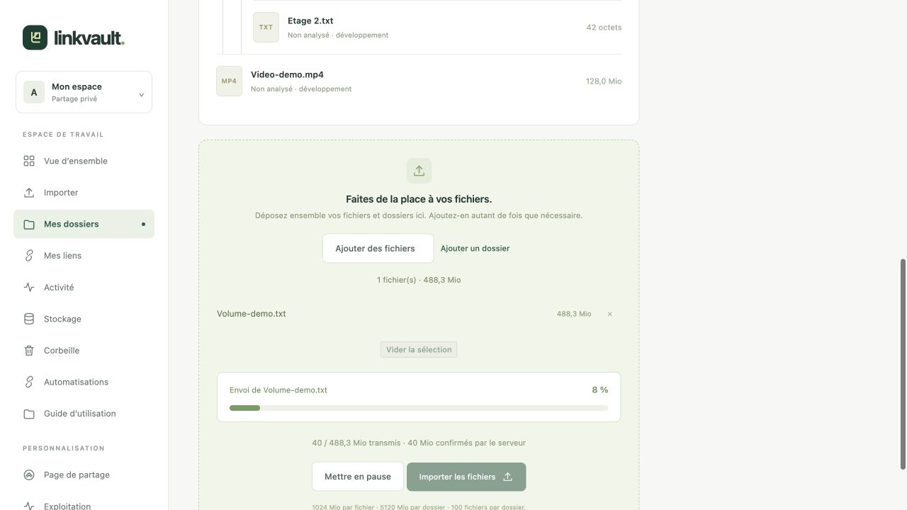

# Importer des fichiers et des dossiers

## Choisir la destination et préparer la sélection

1. Ouvrez **Importer**, choisissez un dossier existant puis **Utiliser ce dossier**. Créez d’abord un dossier si la liste est vide.
2. **Déposez ensemble des fichiers et des dossiers** dans la même zone. Les dossiers et sous-dossiers sont lus automatiquement. Vous pouvez aussi utiliser **Ajouter des fichiers** ou le raccourci **Ajouter un dossier** : le sélecteur natif du navigateur distingue ces deux choix.
3. Ajoutez d’autres éléments autant de fois que nécessaire : ils s’ajoutent à la sélection précédente. Un chemin déjà sélectionné est conservé sans être remplacé. Le bouton **×** retire un fichier de la sélection ; **Vider la sélection** recommence la préparation sans supprimer les fichiers déjà enregistrés.
4. Vérifiez l’arborescence, les tailles et le total, puis cliquez sur **Importer les fichiers**. Le navigateur peut demander de confirmer l’accès au dossier choisi.

Les fichiers restent dans leurs sous-dossiers, dans la page du propriétaire, chez le destinataire et dans le ZIP. Les dossiers sont regroupés dans leur ordre de première apparition ; les nouveaux envois s’ajoutent après les précédents. Les fichiers cachés (notamment `.DS_Store`) et les dossiers vides ne sont pas importés. Si le navigateur ne permet pas le dépôt de dossiers, utilisez **Ajouter un dossier**.

Par défaut : 1 Gio par fichier, 5 Gio par collection et 100 fichiers maximum, y compris la corbeille et les envois en attente. Les limites de votre instance sont affichées sur la page. Les chemins relatifs dangereux, les collisions entre fichiers et dossiers et les extensions interdites sont refusés. La profondeur maximale est de 20 composants de chemin.

## Suivre le transfert réel

La barre progresse avec les octets réellement transmis par le navigateur, y compris à l’intérieur du bloc de 4 Mio en cours. Le détail distingue les octets **transmis** des octets **confirmés par le serveur**, après vérification d’intégrité. La vitesse et le temps restant sont des estimations dépendant de votre connexion ; il n’y a pas de minuteur simulant l’envoi.

**100 % termine le transfert, pas l’ensemble de l’import.** L’analyse antivirus et l’enregistrement suivent dans une phase séparée. Gardez la page ouverte, particulièrement pour un dossier volumineux. Après réussite, vous retrouvez la collection avec ses fichiers. En production, un refus ou une indisponibilité de l’antivirus bloque l’import.

## Mettre en pause, reprendre ou annuler

**Mettre en pause** interrompt la requête du bloc en cours. Les blocs confirmés sont conservés. Cliquez sur **Importer les fichiers** pour reprendre. Après un rechargement ou une coupure, sélectionnez les mêmes fichiers et dossiers : le serveur retrouve leurs positions pendant 24 heures. Un bloc non confirmé peut être envoyé à nouveau ; il n’est pas compté deux fois.

Les envois en attente proposent **Annuler cet envoi**. Cette action libère le quota réservé ; la maintenance supprime les sessions expirées. Un compte peut avoir cinq envois en attente. Figez d’abord les anciens liens actifs depuis **Versions**, ou révoquez-les. Les nouveaux liens peuvent conserver une version figée ou suivre les mises à jour. Voir les [versions et remplacements](versions.md).

Si le quota ou le disque est plein, utilisez [Stockage](storage.md) ou contactez l’administrateur. En cas de refus antivirus, examinez le fichier original sans désactiver la protection.

Sans JavaScript, un formulaire simple pour fichiers individuels reste disponible, limité à 500 Mio par requête. Les dossiers, la progression et la reprise nécessitent JavaScript. Pour automatiser, consultez l’[API](automation.md).
