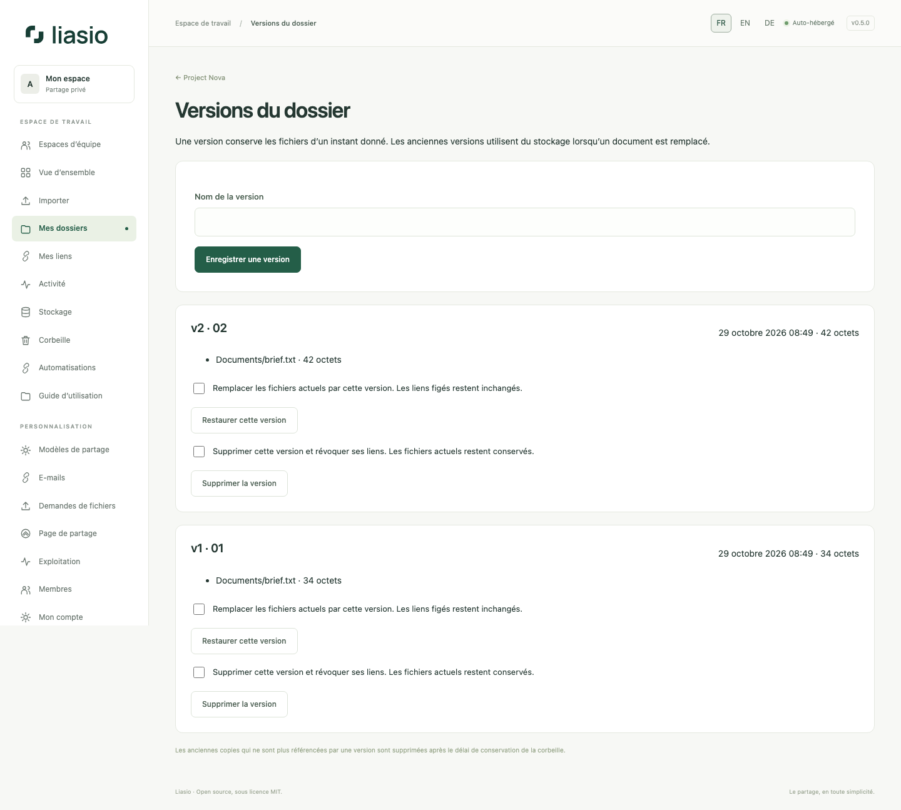

# Versions et téléchargements sélectifs

Dans un dossier, ouvrez **Versions**. Une version conserve les fichiers et leurs octets immuables, pas une copie de la présentation ou du branding. Limite : 100 versions par dossier. Les instantanés automatiques identiques réutilisent la dernière version ; un instantané nommé peut être enregistré volontairement.

À la création du lien, laissez **Suivre les futures mises à jour** décoché pour figer ses fichiers. Choisissez une version existante ou les fichiers actuels. Activez le suivi seulement si le destinataire doit voir les futurs ajouts et remplacements. Version figée et suivi sont incompatibles.

Pour remplacer un document, cochez **Remplacer les fichiers de même chemin et conserver leur version précédente** dans l’import. Le chemin, dossiers compris, détermine le remplacement. Les liens figés gardent les anciens octets ; les liens avec suivi affichent le remplacement. Le nouveau fichier entier compte dans le quota tant que les anciennes copies subsistent. Réglez d’abord tout conflit de chemin avec la corbeille.

Pour les liens antérieurs à 0.5, utilisez **Figer les anciens liens** avant de modifier le dossier : URL, conditions et compteurs restent identiques. Sinon, les anciens liens actifs bloquent toujours les modifications.

Le propriétaire peut restaurer une version après avoir terminé les imports en cours. Les fichiers actuels sont sauvegardés d’abord ; les liens figés ne changent pas. Supprimer une version révoque ses liens et conserve les fichiers actuels. Les anciennes copies sans référence sont purgées après le délai de conservation de la corbeille. Un fichier référencé ne peut pas être purgé individuellement : supprimez d’abord sa version ou le dossier entier.

Sur la page destinataire, **Télécharger les fichiers** récupère l’archive complète. Les cases à cocher permettent une sélection : un fichier restitue l’original, plusieurs produisent un ZIP conservant les chemins. Chaque action consomme un téléchargement autorisé. Consulter la page/les aperçus n’en consomme pas ; une interruption peut conserver la consommation de l’autorisation.
