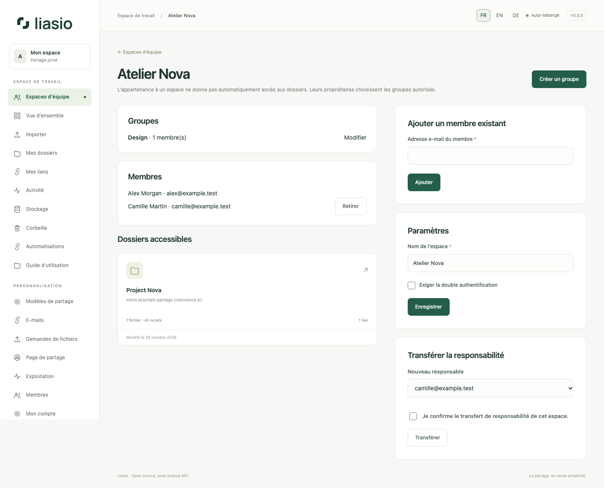

# Espaces d’équipe, groupes et propriété

1. Ouvrez **Espaces d’équipe**, nommez un espace et créez-le. Vous en devenez responsable. Ajoutez les membres actifs par e-mail ; invitez d’abord les nouveaux comptes depuis **Membres**.
2. Créez un groupe, nommez-le et sélectionnez ses membres. Seul le responsable de l’espace modifie groupes et membres. Limites : 200 membres et 100 groupes par espace, 20 espaces gérés par compte.
3. Dans un dossier qui vous appartient, ouvrez **Équipe et propriété** et rattachez-le à l’espace. Accordez à chaque groupe le rôle **Lecteur**, **Collaborateur** ou aucun accès. L’appartenance à l’espace ne révèle pas automatiquement les dossiers.
4. Le lecteur consulte et télécharge. Le collaborateur peut aussi modifier la présentation, importer, gérer liens/lots/exports et créer des versions. Le propriétaire conserve la suppression des fichiers, les droits d’accès, la restauration/suppression des versions et le transfert de propriété.
5. Pour transférer un dossier, saisissez l’e-mail d’un compte actif et confirmez. Dans un espace d’équipe, ce compte doit en être membre. Fichiers et URL restent conservés ; tous les octets, corbeille et historique compris, passent dans son quota. Un quota insuffisant bloque l’opération. Les imports en cours sont annulés. L’ancien propriétaire ne conserve que ses éventuels droits accordés séparément.

Le responsable choisit les membres des groupes : donner accès à un groupe suppose de lui faire confiance. Les droits individuels restent indépendants. Un retrait bloque les opérations suivantes et annule les imports s’il ne reste aucun droit collaborateur. Révoquez séparément les liens destinataires lorsque nécessaire. Détacher le dossier retire les droits de groupe mais conserve les accès individuels.

Activez votre TOTP, puis **Exiger la double authentification** dans l’espace. Les membres sans MFA doivent l’activer avant d’utiliser leur compte/API. Vous pouvez transférer la responsabilité de l’espace à un membre existant ; la propriété des dossiers ne change pas automatiquement.

Voir [le compte](account.md) et [les versions](versions.md).

Pour supprimer un groupe, modifiez-le, cochez la confirmation puis choisissez **Supprimer le groupe**. Ses droits sont retirés ; les accès individuels et les autres groupes restent applicables.
